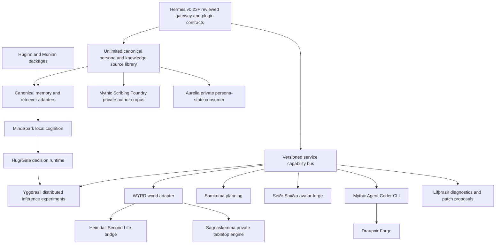

# RuneForgeAI Hermes Hack: 2026 Modernization, Living Persona, and Ecosystem Convergence Roadmap

**Owner:** Volmarr / RuneForgeAI  
**Repository:** https://github.com/hrabanazviking/hermes-agent-RuneForgeAI-hack  
**Prepared:** 2026-11-07  
**State:** New development plan, not a claim that its work has been implemented  
**Primary target:** Update the existing personal fork against current official Hermes, refresh each already-connected external engine, and make the entire RuneForgeAI ecosystem usable without sacrificing distinct project ownership, privacy, or human-authored personality.

> **North star:** A persona or knowledge document may be arbitrarily long on disk, remain complete and editable, and never be silently trimmed or rewritten merely to squeeze it into an LLM prompt. Only the *retrieved active context* is limited by the selected model, tool budget, and operator policy. The authored corpus itself has **no artificial character or token ceiling**.

## 0. Read this before changing code

This is a follow-on roadmap to existing, substantially implemented campaigns, **not** a replacement for them. In particular consult:

- `CUSTOMIZATIONS.md`, the intentionally detailed feature and verification ledger;
- `CAMPAIGN_STATE.md`, declaring the four earlier campaigns complete on November 1;
- `ARCHITECTURE_VOLMARR.md`, the domain-boundary and ownership contract;
- `VOLMARR_HERMES_PERSISTENT_ENTITY_ROADMAP.md`;
- `VOLMARR_HERMES_EMERGENT_AGENCY_ROADMAP.md`;
- `VOLMARR_HERMES_SELF_AWARE_AGENCY_ROADMAP.md`;
- `PERSONA_RUNTIME_ROADMAP.md`, ``3–94;
- `UPSTREAM_SYNC.md` and `scripts/sync_upstream.py`;
- `COMPONENT_LICENSES.md`, `THIRD_PARTY_NOTICES.md` and project-specific license manifests;
- `HERMES_PROJECTS_UPDATE_2026-10-30.md` (a **historical snapshot**, not a substitute for reading each project's latest repository).

Do not duplicate implementations that already exist. **Reconcile, expose, update, integrate, prove.** Several existing persona sections are pure, testable contracts with *no current caller*, not a fully wired production persona engine. Several external engine bridges are health/preflight-only. The work below must explicitly move those into real user-facing behavior before claiming completion.

### 0.1 Verified baseline as of this document

- Fork `main` observed at `8233a43ee6c9b056d5c042bc04661b5628444f0b`, latest commit November 1, 2026, “Slice 164: Persona Runtime `93 Target Result + `94 Essence — roadmap complete.”
- Last **documented upstream integration**: `NousResearch/hermes-agent` at `6bb377a51d5c8e279a7a5e34d717d653d421d064`, merged October 30, 2026. Do **not** call the fork current to the latest upstream on November 7.
- Official upstream stable release checked for this plan: **v0.23.0, “The Hearth Release,” published November 5, 2026**, https://github.com/NousResearch/hermes-agent/releases/tag/v0.23.0. The official `main` branch continues changing after the release: inspect its SHA again at execution time.
- Upstream compare from the October 30 intake SHA to a November 7 upstream `main` snapshot reported **2,759 later upstream commits**. That is a maintenance signal, **not** a claim about merge conflicts or the count of missing features in the fork.
- Existing opt-in plugins observed: `volmarr-core` 0.26.0, `volmarr-voice` 1.0.0, `volmarr-astrology` 0.7.0, `volmarr-tarot` 0.3.0, `volmarr-seidr` 0.4.0, `volmarr-rpg` 0.8.0, `volmarr-hamr` 0.4.0, `volmarr-smidja` 0.1.0 and `kista-secret-source` 0.2.0. **Plugin manifest versions are not external-engine version numbers.**
- November 1 campaign records: 117 Volmarr/Kista test files, **929 passed, 7 failed, 1 skipped** in a combined interrupted-plus-restarted verification. Seven named failures were reported as recurring environment-dependent failures (five core-plugin, one Verðandi-socket, one voice loopback). These are historical reported results, **not tests re-run for this roadmap**.
- Existing Persona Runtime consists of a large `plugins/volmarr-core/persona_runtime.py` with deterministic compiler, persona IR, kernel, stable section IDs, retrieval/routing/budget prototypes, drift and audit surfaces, roster and import/export contracts. Major gaps remain: live prompt integration, semantic similarity provider, verified hot reload in an active gateway, real operator commands for portions of the surface, large-corpus performance and durability.
- Current base Hermes `agent/prompt_builder.py` uses per-file context truncation, a dynamic floor/ceiling and optional `context_file_max_chars` override. As observed here, its dynamic default has a **20,000-character floor and 500,000-character ceiling**; this is not arbitrary-sized context-file ingestion. The built-in memory tool defaults to `memory_char_limit=2200` and `user_char_limit=1375`.
- The existing `SOUL.md` in repository root is a checked-in example/instruction file; the active Hermes identity file typically resides under the selected `HERMES_HOME`. Preserve this distinction when migrating.

### 0.2 Ground rules

1. **Preserve the personal README additively.** The upstream sync script must continue to protect its bytes during automatic upstream intake. Hand-authored dated additions are allowed when requested by Volmarr.
2. **Native-first, no Docker required.** Native Linux/Kubuntu, ARM64 Linux and Termux/Android are primary. Docker-specific tests may exist upstream but are not a prerequisite for this personal deployment.
3. **The Hermes framework remains upstream-compatible.** Personal code belongs in plugins, providers, hooks, tools, skills, gateway adapters, optional services or narrowly reviewed interfaces.
4. **Keep project code in its original project.** Use versioned packages, APIs, sidecars and declared compatibility ranges. Avoid copy-pasting whole project trees into Hermes.
5. **Profiles, users and entities are separate namespaces.** Shared tools do not imply shared identity, accounts, private history or secrets.
6. **Do not sacrifice data to meet a prompt limit.** Complete originals stay on disk, indexed and recoverable. Trimming only affects a single active prompt packet with an explicit receipt.
7. **Never silently route private local material to a cloud model, telemetry sink or third-party account.** External destinations need a source-level routing policy and authorization.
8. **Replace “it looks implemented” with demonstrated acceptance.** Unit, integration, subprocess, transport, recovery, performance, privacy and actual user-facing behavior tests are distinct proof.
9. **Do not confuse roadmap completion with operational capability.** Previous `93–94` “complete” means their defined contracts and tests were banked; it does not prove an on-by-default live personality engine.
10. **No destructive auto-upgrade.** All migration steps preserve backups, have a dry-run, produce a provenance report and offer rollback.

## 1. Deliverables and completion definition

The modernization campaign produces:

1. A reproducible, pinned upstream Hermes intake at a chosen release/SHA with a tested integration branch and documented conflict resolutions.
2. A maintained source-and-version inventory of **all existing RuneForgeAI external integrations**, their installed APIs, HEAD/release, licenses, capabilities, and verified adapter level.
3. A living, **uncapped corpus** of persona and knowledge Markdown: `SOUL.md`, `IDENTITY.md`, `AGENTS.md`, `USER.md`, `MEMORY.md`, `SERVICE_BIBLE.md`, `RELATIONSHIPS.md`, `MEMORY_POLICY.md`, `TOOL_POLICY.md`, `AVATAR.md`, lorebooks, spiritual/cultural canons, character sheets, project documents and any new operator-defined role.
4. A streamed compiler/index that stores **all** authored content, supports huge files and repositories, and generates only bounded retrieval packets at inference time.
5. A live persona **kernel → retrieval → active-context** pipeline serving CLI, TUI, Web, Desktop, gateway, cron, voice and delegates uniformly.
6. Operator tooling to inspect, explain, search, reload, diff, export, import, back up, test and repair persona corpora without altering authored text.
7. A unified ecosystem adapter set: memory, cognition, hardware, voice, avatar, creative tools, multiplayer communication, coding, worlds and edge inference, all opt-in with truthful capability reporting.
8. A documented runtime/UX distribution recipe for the ROG Flow Z13, the RTX 2060 secondary laptop, Pi 5, Android/Termux, offline operation and selectively authorized cloud inference.
9. Repeatable regression suites plus a launch audit distinguishing **ready**, **prototype**, **external-unavailable**, **design-only** and **blocked**.

**Exit:** a fresh native install can ingest a multi-megabyte `SOUL.md` plus numerous arbitrary-length files, find any chosen section by stable provenance, apply the correct identity in a real chat, survive restarts and a model swap, and expose all configured working RuneForgeAI tools without regression against the selected official Hermes baseline.

## 2. Architecture and non-negotiable invariants

```text
                           HermES user surfaces
             CLI | TUI | Desktop | Web | Voice | APIs
                              |
                      one gateway / session owner
                              |
       official Hermes tool / model / hook / skill boundaries
                              |
            RuneForgeAI personal composition plugin
            +------------------------------------+
            | ENTITY ID    PERSONA RUNTIME      |
            | continuity   canonical MD library |
            | goals        compiler/index/kernel |
            | affect       section retrieval     |
            | autonomy     consent / provenance  |
            +------------------------------------+
                 |        |        |       |
              Verðandi  Bifröst   WYRD    HugrGate
                 |      and       |       / routing
              events   memory    world     |
                        fabric   truth    A.E.S.I.R.
                 +--------------------------------+
                 | native external RuneForge APIs |
                 | Tarot / astro / Seiðr / RPG   |
                 | Hamr / Smiðja / voice / worlds|
                 | Samtal / Samverk / coding etc.|
                 +--------------------------------+
```

**Invariant A, authored canon:** complete source Markdown remains authoritative for defining persona identity and user-directed style. Retrieved conversation summaries and agent observations cannot silently rewrite it.

**Invariant B, state separation:** lived experience (memory), assertions about the agent's current state, world facts, tools, model configuration and authored identity are different types. Explicit reconciliation is needed when they conflict.

**Invariant C, losslessness:** stored source bytes plus a content digest remain available after indexing, retrieval, compaction, import, export, backup, platform move and cache rebuild.

**Invariant D, bounded execution:** a user may own a terabyte-scale corpus in principle, but no request may consume unlimited tokens, RAM, process time, open file descriptors or provider charges. Caps on *execution* are configurable and observable; no arbitrary character-size truncation of the underlying documents occurs.

**Invariant E, personal/private scope:** model provider, entity, user, project and private/public context labels accompany every retrieval chunk and every external call.

**Invariant F, truthfulness:** absence of a backend is “unavailable,” not “working.” A preflight adapter is not a full integration. An architecture proposal is not running production code.

---

# PART I — Bring the upstream foundation forward

## 3. Phase U0: evidence freeze, backups and operator inventory

**Goal:** know exactly what exists before any merges or upgrades.

- Pin fork `main` SHA, official release SHA, official `main` SHA, configured deployment `HERMES_HOME` roots and every external engine checkout; record timestamp and source URL.
- Export `git status`, working-tree diff, git remotes, branch references, installed plugin manifests, active profiles, Hermes config, service versions, local checkout paths and platform/kernel information. **Never** publish credentials or private directory contents.
- Snapshot active databases using SQLite backup APIs, not a blind copy of an open WAL database. Back up `entity/`, `memory/`, `config/`, user-authored persona corpus, plugin config and systemd user units with permissions retained.
- Capture hashes for README, edited core files, persona docs and plugin manifests. Keep a versioned manifest separate from the source files.
- Enumerate existing live and legacy profiles; distinguish a public repo `SOUL.md` from every profile's effective `SOUL.md`.
- Establish a clean native disposable profile for test runs; avoid running migrations against the active companion.
- Write `docs/modernization/BASELINE_2026-11-07.md` and a machine-readable `integration-lock.json`. Record unknowns explicitly.

**Acceptance:** reproducible baseline, decryptable backup verification using a *test* vault, explicit restore procedure and no changes to running deployments.

## 4. Phase U1: guarded upstream Hermes v0.23+ intake

**Research inputs:** https://github.com/NousResearch/hermes-agent, https://github.com/NousResearch/hermes-agent/releases/tag/v0.23.0, https://hermes-agent.nousresearch.com/docs .

Target the latest **reviewed** official SHA, starting with v0.23.0 as the release reference, not automatically an unreviewed moving `main`.

### 4.1 Intake procedure

1. Create `integration/upstream-2026-11-07` from the frozen personal SHA.
2. Run the checked-in `scripts/sync_upstream.py` exactly as governed by `UPSTREAM_SYNC.md`. It must preserve the personal README byte-for-byte while staging upstream changes.
3. Produce `upstream-changes.md` summarizing relevant release/API changes, breaking changes, dependency migrations and conflicts. Diff by features and ownership, not just filenames.
4. Review changes to `agent/prompt_builder.py`, `tools/memory_tool.py`, plugin discovery/registration, provider APIs, gateways, session model, profiles, `hermes_state_*`, secrets and configs.
5. Resolve each conflict using a source-annotated minimal union; never silently choose upstream or the fork for a whole file.
6. Re-run all upstream targeted tests, all `tests/plugins/test_volmarr_*.py` and Kista tests, then native startup and user-facing smoke checks. Use `scripts/run_tests.sh` per the repo's existing test discipline.
7. Compare behavior with the untouched frozen personal build and untouched official build. Diagnose the seven previously recorded failures in an environment where real sockets/endpoints are available rather than assuming they still have the same cause.
8. Keep release notes, docs, tests, DB schema migrations and plugin interface versions in sync before merging.
9. Report HEAD SHA and hash preservation, merge provenance and unresolved defects before promoting to `main`.

### 4.2 Upstream features demanding explicit compatibility work

The official **v0.23.0 Hearth Release** introduces or consolidates substantial features, including:

- **Single gateway-owned sessions:** ensure personal identity, Present State, event hooks, continuity receipts and persona caches resolve to *the same session owner* from CLI, TUI, Desktop, Web and cron. Prevent duplicate hooks and writes.
- **Desktop-in-browser/Webapp:** expose personal plugin controls and persona status through supported interfaces without embedding secrets or private docs in public JS bundles.
- **Group Chats and Bot Mode routing:** support independent persona IDs and memory namespaces for each bot/participant; group messages never share private state by accident.
- **Conversation rewind/fork:** branch memories and current-state mutation logs coherently, avoiding irreversible canon updates from discarded branches.
- **Multi-host / remote Desktop:** respect remote session ownership, verified profile identity, network trust and authorized encrypted transports. A local A.E.S.I.R. loopback endpoint on a remote host is not the local machine's loopback.
- **Plugin update/catalog lifecycle:** isolate personal plugins from auto-replacement and audit new plugin API compatibility. Allow pinned / staged upgrades, not blind latest.
- **Paid MCP tool spend limits and richer telemetry:** combine Hermes accounting with RuneForge's local/deep model policy, cost ceilings and permission gates.
- **Pluggable delegation:** convey persona identity, prompt policy, authority scope, effective project, tool limits and provenance through narrow handoff packets.
- **Long-lived gateway memory/latency work:** check cache invalidation, on-disk session indexes and fast-path hooks under sustained load.
- **Terminal image display and changed UI flows:** compatibility smoke for Konsole/Kubuntu, TUI, headless/SSH and remote presentation surfaces.

**Acceptance:** all personal plugins discover and work against upgraded official contracts; selected upstream integration passes required upstream tests; documentation clearly lists any intentionally deferred upstream features.

## 5. Phase U2: dependencies, trust and deployment modernization

- Compare `pyproject.toml`, `uv.lock`, Python compatibility, Node/desktop lockfile, Rust/Tauri packages and plugin toolchains against the selected upstream pin. Never treat a package name as verified safe merely because it is latest.
- Reconcile the retained `pyyaml==6.0.3` dependency with upstream's YAML stack; test actual installed wheels on x86_64 and ARM64.
- Preserve the opt-in **Muninn/Huginn editable-path mapping**. Their unpublished packages collide with unrelated names on PyPI; block resolver fallback, document source SHA and supply a future first-party package/repo publication route. Fix the lock regeneration gate rather than weakening supply-chain freshness rules.
- Build one `adapter compatibility matrix`: Hermes release, plugin API, engine version/SHA, Python ABI, OS, architecture, required credentials, resource budget, smoke test.
- Integrate dependency audit, SBOM, provenance checks, license notice checks, leak scanning, static analysis and platform CI. Distinguish upstream-owned, fork-owned and separately licensed external components.
- Offer native source-install and isolated virtualenv services, sensible systemd units, health endpoints, log rotation and rollback. Do **not** require Docker.
- Keep volatile inference/model caches out of portable identity backups; document rehydration.
- Stage upgrades in throwaway profiles and test with intentionally offline/cloud-denied operation.

**Acceptance:** lockfile reproducible from declared sources; no ambiguous PyPI ravens; no functional loss when optional engines are missing; supported machines have a native launch and rollback recipe.

---

# PART II — Unbounded SOUL.md, persona and knowledge documents

## 6. Phase P0: define “unlimited” accurately and end silent truncation

**User requirement:** no small fixed limit on the size of `SOUL.md` or other personality/knowledge Markdown.

**Implementation:** remove artificial **authored-document** limits for selected trusted persona stores, not physical or model resource limits.

Current Hermes behavior observed at the frozen snapshot:
- `agent/prompt_builder.py` has `CONTEXT_FILE_MAX_CHARS = 20_000`; dynamic model-dependent caps climb to a 500,000-character ceiling by default; `context_file_max_chars` can override.
- `load_soul_md` uses the context-file truncation function. It normally retains head and tail with an omitted-middle marker; the agent can sometimes retrieve the remainder manually, but that is **not** acceptable as the foundation of a giant persona.
- `tools/memory_tool.py` instantiates curated memory with 2,200 and 1,375 character defaults, respectively. They are distinct from a full historical memory corpus.
- The personal persona compiler already treats authored Markdown sections as canonical, but its runtime and storage paths are not the normal unconditional live prompt path.

### New guarantees

1. A canonical persona document is **never truncated during storage, import, export, edit, hash, backup or indexing**.
2. The complete corpus can grow without a fixed 20K, 500K or other authored-text character ceiling. No maximum page count or maximum number of user-authored source files baked into the schema.
3. If any document exceeds one active model context window, the system retains everything and retrieves only task-relevant sections into a **separately managed** bounded packet.
4. Explicit source status: `complete`, `unindexed`, `indexing`, `indexed`, `outdated`, `unreadable` or `corrupt`. Never conflate “not in this prompt” with “not stored.”
5. Strict operator controls for per-turn token, inference latency, CPU, RAM, disk, rate and spending budgets; these are about the operation, **not an artificial source-size cap**.
6. No silent loss of author intent: preserve Markdown bytes, Unicode, headings, links, comments, front matter, verse, tables, code and long sections. Derived canonical normalization for search must not replace source text.
7. User-owned persona documents do not become data-training uploads merely because a cloud model is configured.

**Tests:** 1 KB, 20 KB, 501 KB, 5 MB, 100 MB and streamed multi-file corpus tests; Unicode and giant section adversaries; low-memory failure/restart behavior; exact source digest before/after; output packet always bounded. Scale beyond these sizes as hardware permits without changing a hard-coded schema maximum.

## 7. Phase P1: canonical source library and open document schema

### 7.1 Hierarchical storage

Suggested profile-specific layout (illustrative, no hardcoded identity names):

```text
HERMES_HOME/
  personas/
    <persona-id>/
      persona.yaml               # role map, priority and trust rules
      canonical/
        SOUL.md
        IDENTITY.md
        SERVICE_BIBLE.md
        RELATIONSHIPS.md
        MEMORY_POLICY.md
        TOOL_POLICY.md
        AVATAR.md
        WORLDVIEW.md
        KNOWLEDGE/
          culture/*.md
          lorebooks/*.md
          worlds/*.md
          projects/*.md
          research/*.md
          custom/**/*.md
      generated/
        manifest.json             # derived, deletable/rebuildable
        sections.sqlite           # FTS + immutable source refs
        semantic/                 # optional vector index
        kernels/                  # derived versioned kernels
        receipts/                 # reload, diff, retrieval audits
      backups/                    # operator-controlled snapshots
  memories/                       # lived memories, separately scoped
  entity/                         # identity, self state, goals, affect
```

`SOUL.md` remains fully supported as the familiar default entrypoint, but is **only one document**. New roles and directories require metadata, not code edits. Project `AGENTS.md` or `.hermes.md` files also remain usable as contextual instructions, while per-persona identity has its own trust and priority boundaries.

### 7.2 Manifest fields

Each source record defines:
- stable `document_id` and semantic `role`;
- source path, storage namespace, ownership and author-editable flag;
- SHA-256 of **original bytes**, revision, optional external source revision;
- human-readable label, locale, Markdown dialect, tags and category;
- priority (P0–P4), trust class, privacy class, destination/tool restrictions;
- effective persona ID and shared-vs-personal memory scope;
- optional chapter/section anchors, linked directories and include rules;
- source length for diagnostics only, never as an admission ceiling;
- last seen/compiled/verified timestamps, read-only mirror provenance;
- conflict-resolution policy, active/archived state, migration format.

Explicitly **no** `max_chars` or `max_tokens` on canonical documents. Operational import pacing and indexing work quotas live elsewhere.

### 7.3 Source ingestion and edits

- Implement streaming filesystem reads, bounded parser work units, cancellable indexing, concurrent safe reads, atomic manifest updates and resume checkpoints.
- Read UTF-8 losslessly; support configurable encodings only with explicit operator consent and round-trip verification.
- Permit one file, many selected files, a folder tree, local Git checkout or separately authorized connector source. Preserve originals and source revisions.
- Add a watch strategy (mtime as a hint, hash as authority) plus manual refresh. Debounce writes, avoid watching generated indexes recursively.
- Never auto-edit or “optimize” user text. AI may propose patches to a diff queue; the operator accepts or rejects changes to canonical files.
- Include Markdown AST edge cases: nested heading levels, no-heading files, enormous paragraphs, code fences, tables, inline images, duplicate headings, deterministic renamed headings, relative links, citations and CRLF.
- Make `include` expansion cycle-safe and path-safe; reject symlink escapes by default and surface precise diagnostics.
- Support corpus migrations with dry-run, idempotence and rollback; compile caches are disposable, source documents are not.

**Acceptance:** any authored text survives 100 import/export/reindex cycles byte-for-byte; the selected persona can list every source and its origin; no accidental path traversal or leaked cross-profile file.

## 8. Phase P2: incremental section index, retrieval and full-fidelity read

Build on `plugins/volmarr-core/persona_runtime.py` (``3–16) and existing Bifröst/ChatIndex/MemPalace concepts. Do not create a competing persona compiler.

### Indexing architecture

- Parse in a streaming or paged manner, with section identity independent of source byte offset where possible.
- Store exact original byte ranges plus normalized search fields and stable IDs in transactional SQLite; FTS5/BM25 is the guaranteed local baseline.
- Very large headings or sections gain **logical subspans** with parent section identity, offsets and overlap metadata; subspans are retrieval aids only and never mutate or pretend to replace the canonical section.
- Preserve whole-section retrieval when it fits the caller's active budget; when it does not fit, use precise extract windows, quote spans and continuation handles. Make omitted material visible through “more from this section” navigation.
- Content address derived artifacts by source hash and compilation version; update only changed files/sections; garbage-collect obsolete indexes only after a successful new snapshot.
- Search query combines lexical FTS, heading/role/tag weights, deterministic task classification and optional vector similarities; vectors can be rebuilt without loss.
- Semantic embeddings are opt-in, version-pinned and provider-aware: local-first via A.E.S.I.R. or a chosen local embedding server, cloud only after explicit per-source authorization.
- Handle morphology and multilingual Markdown; measure Old Norse names, runes, diacritics, code, prose, tables and mixed languages.
- Retrieval receipts show query, source/section IDs, trust, score components, budgets, chosen spans and why other sections were omitted.
- Add “exact citation” mode returning source path + line/offset and hash; separate from derived summary snippets.
- Integrate read-only full-document paging/search into CLI/TUI/Web; return full file on an explicit tool read in safe paginated parts, never a deceptive “full” truncated blob.

**Acceptance:** exact-match recall against buried passages in 100 MB corpora; zero text loss; stable references after unrelated edits; index rebuild under constrained memory; no cloud data egress in fully offline mode.

## 9. Phase P3: irreducible persona kernel and prompt assembler

The **kernel** is *not* a forced-shortened replacement for a person's full identity. It is the minimal, human-reviewable identity anchor that is always available at runtime. The corpus remains unlimited behind it.

- Reuse ``5–10/15–18/53–54/65–68 of the existing persona module. Identify missing real gateway hooks rather than writing another pure contract helper.
- Compile verbatim essential P0/P1 identity/relationship/boundary passages and generate a versioned kernel with hash, provenance and priority.
- If essential authored material exceeds a single kernel target, retain its complete text in canon, pin essential short anchors and require deterministic retrieval/continuation. **Never discard it as “too long.”**
- Allow operator selection of micro/standard/large kernel profiles and explicit token budgets per model; the core identity checksum must remain stable across model switches.
- Standard prompt order: upstream trusted runtime controls → pinned persona kernel → authorized current state and relevant memory → task-relevant persona / project / world context → actual user turn. Preserve upstream tool and role semantics.
- Do not inject a giant raw `SOUL.md` via the old head/tail truncation path **as well as** the new kernel. A verified handoff switches ownership of the persona prompt to the compiler, with an explicit fallback to unchanged Hermes behavior when the plugin is disabled.
- On context pressure, expire low-priority retrieved context first; never silently replace the kernel, fabricate a compressed personality, or mutate sources.
- Preserve prompt-cache friendliness: stable compiled kernel prefix; dynamic retrieval added later in the prompt, sorted deterministically and deduplicated.
- Provide explicit context-window headroom for tools, user input, completions and attachments. Report “required identity exceeds usable model context” instead of pretending all text was injected.
- Expose exact source manifests and context packet receipts to the operator, not to untrusted tools or unauthorized remote participants.

**Acceptance:** first turn and after 1,000 turns use the same pinned persona fingerprint; live prompt tracing confirms actual insertion; no duplicate `SOUL` injection; disabled plugin preserves official Hermes output.

## 10. Phase P4: live runtime integration across every surface

- Connect compiled persona activation to the **single gateway session owner** selected after upstream intake.
- Resolve persona ID and version once per turn; snapshot it immutably for the duration of that turn. Mid-turn edits compile a new generation, then activate atomically for the **next** admitted turn.
- Rebuild on restart, file change or explicit reload; validate before activation; refuse partial generations; retain last known-good hash on index failure.
- Add default-off adapter to supported `pre_llm_call`/context-provider API, but use the proper upstream official extension surface; do not monkey-patch internal prompt functions.
- Apply same provenance/priority to cron, delegated agents, bots, group chat, voice calls, background tasks, API runs and web chat.
- Delegates inherit only specified persona fragments, authority and tools. They do not gain the parent's entire private memories or credentials by default.
- Add session rewind/fork semantics: preserve prompt generation receipts and branch-local state; do not commit obsolete turn outcomes.
- Separate multi-persona rosters from user accounts: `persona_id`, `entity_id`, `user_id` and provider credential owner are distinct IDs.
- Validate persona transitions for active long-running voice/avatar sessions, streaming output, interruption, restart, reconnection and remote gateway handoff.
- Ensure the compiler does not run from scratch on every request; retain prepared index handles and cheap hash/invalidation checks.

**Acceptance:** demonstrate different personas with distinct docs on CLI, Web, Desktop, voice and a delegated session, each with no cross-profile contamination and correct restart restoration.

## 11. Phase P5: truly large MEMORY.md and USER.md without losing Hermes semantics

**Important distinction:** official `MEMORY.md` / `USER.md` are curated always-visible prompt snapshots, not currently unbounded databases. Their small default limits can coexist with a new unlimited **backing corpus** only if ownership and UI are explicit.

- Add an opt-in RuneForge **unbounded memory corpus** with user-readable Markdown and indexed structured records. Support importing existing `MEMORY.md` / `USER.md` verbatim without truncation, then retain them as full documents.
- Keep a small **derived memory digest** for context efficiency, *not a replacement* for full user-owned sources. Users may choose not to generate any digest and rely exclusively on retrieval.
- Expose one UI to edit/search entire Markdown, not a small textbox that silently refuses more text. Validate backend and frontend paths, API payload limits, editor virtualization and autosave.
- Make memory writes transactional, append-friendly, immutable-event-audited and explicitly scoped. Current facts can be updated with provenance; episode history is append-only where practical.
- Preserve old Hermes `memory` tool compatibility through an adapter with truthful “full store” vs “hot digest” distinctions. Do not lie to upstream callers about a 2,200-character snapshot now containing 20 MB.
- Integrate session FTS, MemPalace verbatim episodes, Bifröst/Mímir/Huginn/Muninn associations, OpenViking structured context and optional ChatIndex hierarchical retrieval without duplicating ownership.
- Distinguish a *user's authored profile* from observations made by an agent, which may be incorrect or stale; protect against adversarial conversation overwrites of canonical preference and identity.
- Add memory consolidation as reviewable derived metadata with source links; never delete source history merely because a summary exists.
- Support a cold archive and warm/hot indexes; offline-first; no hard lifetime item-count ceiling; optional tiered storage across SSDs and authorized servers.
- Test SQLite WAL and multi-process gateway concurrency, profile rotation, crash recovery, backups, restore, dedupe and migration.
- Keep provider memory plugin contracts compatible and preserve ability to disable the personal memory fabric entirely.

**Acceptance:** 2 MB `USER.md` and 20 MB `MEMORY.md` are stored complete, indexed and available for exact recall, while a small model only receives the most relevant bounded digest/sections. A normal memory tool write cannot silently truncate full files.

## 12. Phase P6: persona operations and character-drift assurance

Reconcile the already banked ``19–94 contracts with *real* CLI, TUI, Web and API entrypoints:

| Proposed command | Operation | Evidence required |
|---|---|---|
| `hermes volmarr persona status` | active ID, hash, corpus size, indexed completeness, effective privacy | actual installed plugin and live gateway |
| `... persona files` | source roles, paths, full length, last indexed hash | exact source inventory |
| `... persona search "query"` | index search with section/line provenance | deep buried-section tests |
| `... persona inspect [section]` | section text, priority, source and effective routing | no invented content |
| `... persona explain [turn-id]` | why given sources were attached/omitted | prompt packet receipt |
| `... persona validate` | AST, roles, priorities, symlinks, conflicting instructions | fault injection |
| `... persona diff` | source and compiled kernel differences | before/after proof |
| `... persona reload --dry-run` | new generation without activation | current generation intact |
| `... persona reload --activate` | validated atomic swap | active in subsequent turn |
| `... persona export` | exact sources, hashes, policy and optional index | round-trip byte identity |
| `... persona import --dry-run` | collision/ownership/license/privacy preview | no mutation |
| `... persona backup/restore` | encrypted or offline integrity-checked snapshot | disaster-recovery drill |
| `... persona test` | golden character/priority/model-swap scenarios | replayable tests |

- Turn `PersonaWatchdog` into a bounded diagnostic service: can report contradictory outputs or drift, but cannot rewrite canon; an optional fast local model may assist in *proposing* an explanation.
- Add model-specific adherence baselines and regression corpora. Avoid numerical claims about inner experience from behavior tests.
- Verify prompt-injection isolation: a web page, repo README, chat log or tool result cannot redefine a canonical persona merely by pretending to be a higher-priority system instruction.
- For authored persona changes, preserve prior revisions and ask the authorized editor to approve meaningful changes.
- Add transparent metrics: missing-source rate, kernel hash stability, retrieval hit@k, conflicts, CPU/memory cost, P50/P95 latency, cloud egress count, wrong-profile incidents and prompt-budget utilization.
- Preserve opt-in personal configuration; upstream stock agents must remain unchanged.

**Acceptance:** all commands operate on a real temporary gateway profile, not just return predetermined example dictionaries.

---


# PART III — Refresh every already-integrated engine

## 13. Phase E0: versioned integration ledger and ownership policy

**Do not interpret “incorporated” as “source code copied.”** Existing connectors include health probes, read-only adapters, optional offline bridges, subprocess tools, metadata contracts, background-state records, and live write paths. They must be classified separately.

Maintain `docs/modernization/INTEGRATION_MATRIX.md` and `integration-lock.json` with, **for every entry**:
- first-party fork plugin name/version, file paths, interface owner and status at baseline;
- upstream official repo URL, owner, latest stable release/commit, current installed package/version/SHA, branch and timestamp;
- license, artifact/content license, attribution, transitive dependencies and redistribution implications;
- current adapter mode: documented, probe-only, read-only, deterministic tool, full read/write, realtime, prototype, design-only;
- compatibility delta, exact schema, error handling, auth, allowed transport, privacy and permission scope;
- platform coverage for x86_64 Linux, ARM64 Linux, Termux and Windows where meaningful;
- installed verification result, absent-dependency result, upgrade needed, rollback plan and responsible roadmap phase.

Do not guess at versions from stale documentation or plugin manifests. Read the **current** canonical source and release notes in the original project's repo at execution time; if there is no release, pin reviewed Git SHAs. Never silently “upgrade” an external engine to an unreviewed moving branch.

### Core existing-integration matrix

| Engine / component | Present fork capability evidenced by code/ledger | Upgrade and integration goal |
|---|---|---|
| **Verðandi** | Opt-in lifecycle metadata bridge, profile-local health, affective stimulus catch-up and event families; Unix socket transport | Compare current socket/event schemas, add replay/ack/reconnect, optionally portable native Windows transport, real latency and privacy tests |
| **Project A.E.S.I.R.** | Loopback health/model catalog, tool-free local reflex execution, deterministic/local/cloud route metadata and telemetry | Reconcile current OpenAI-compatible API, new models/quantizations/multimodal support, GPU/NPU capabilities, streaming, cancellation, benchmarks and local-first provider selection |
| **MindSpark / ThoughtForge** | Referenced as a small-model/reflex concept; no claim of a complete direct runtime adapter | Audit latest native status, extract tested decision interfaces, integrate only where it outperforms deterministic routing |
| **Bifröst/Mímir** | Profile-local read-only probe plus context packet/memory fabric integration | Update to current bridge API; unify precise source IDs, retrieval receipts, dedupe, provenance and consistency |
| **Muninn/Huginn (“ravens”)** | Explicit read/write operations behind optional opt-in flags, local editable packages and schema probes | Publish/lock canonical packages safely, modernize reinforcement, ingestion, association and consolidation with transaction/replay contracts |
| **MemPalace** | Version-checked health probe and optional SQLite BM25 episodic retrieval | Verify latest store schema/official API, add robust incrementals, source citation, deterministic fallbacks and freshness receipts; do not silently activate heavy vector backends |
| **OpenViking** | Catalog provider health and optional memories-only HTTP retrieval | Verify official latest server protocol, provider registration, auth and schema; avoid duplicate provider ownership |
| **Hermes SessionDB** | Read-only preservation/health; Hermes owns transcript | Test v0.23 single-gateway ownership, shared session access, rewind/fork lineage, robust FTS queries |
| **WYRD Protocol** | Health, read-only world get/query, bounded world context, confirmed set/observe with event notifications, restart acceptance verifier | Compare latest official world-model schema, oracle policies and async subscriptions; maintain single source of deterministic world truth |
| **Kista** | Secret-source plugin, exact-value redaction, permission/ACL verification, credential containment tests | Audit latest Kista CLI/library/vault schema; support profile/account separation, rotation and health without exposing secrets |
| **Astrology Engine** | Deterministic lunar, planetary-hours, natal/transit/prediction, synastry and geo-coordinate calculations via subprocess | Refresh engine/ephemeris dependencies and timezone semantics; add opt-in charts and provenance of calculations |
| **RuneTarotEngine** | Seeded reproducible draws, fixed layouts, Golden Dawn correspondences, dignities/balance, no model interpretation in adapter | Refresh official deck/CLI API and tested spreads; add compatible interpretation overlay at agent level, not hidden random replacement |
| **Seiðr Engine** | Seeded Old Norse-inspired metrical composition and validation plus catalog tools | Refresh meter/kenning API and lexicon; preserve repeatability and language-source provenance |
| **RPG/SRD & Norse Saga** | Dice, checks, binary oracles, user-owned random tables, character skeleton, lookup and repeatable mechanics | Integrate current Sagnaskemma engine behind clear license boundary, combat/encounter and stateful table sessions |
| **Hamr** | Read-only spec/preset/budget/artifact preflight | Audit current VRM/GLB exporter contracts, Blender compatibility, artifact inspection and opt-in render jobs with cleanup |
| **Seiðr-Smiðja** | Read-only Loom/Hoard/Gate/Oracle Eye and Blender readiness adapter | Reconcile official forge pipeline, validate assets/licenses and implement opt-in artifact builds with explicit costs |
| **AIAvatarKit presentation** | Versioned outbound envelope and loopback/manual runner contract | Consume **output-only** avatar animation/render interface when supported; never start an unwanted microphone or duplicate conversation agent |
| **Open-LLM-VTuber** | Documented architecture audit, no admissible output-only embed at last audit | Reevaluate current upstream; if still owns ASR/TTS/agent loops, do not graft it into an incompatible stack; propose separate display adapter |
| **OmniVoice / native Hermes voice** | Voice readiness reports and transport/presentation adapter | Pin compatible STT/TTS/VAD, low-latency audio, interruption, streaming avatar visemes and privacy |
| **Persistent identity / affect / goals / agency** | Many explicit versioned state modules, contract tests and bounded default-off jobs | Consolidate integration points, eliminate redundant stores, connect truthfully to live turns and prove restart continuity |

### Per-engine upgrade protocol

For **each row** above perform the same sequence:

1. Fetch remote tags/releases, project metadata, current branch SHA, migration guides and test fixtures.
2. Compare against the pinned revision referenced in the Hermes adapter or documentation; enumerate changed public APIs, schemas, CLI flags and return formats.
3. Run the external engine's **own** tests in its own reproducible native environment before touching Hermes.
4. Publish a versioned compatibility fixture or service contract with representative good/bad samples.
5. Update the Hermes adapter with adapters for old and new stable versions where feasible. Prefer a clean capability negotiation over guessing versions.
6. Exercise real end-to-end calls in a disposable profile with synthetic data; prove no side effects when a health-only operation is requested.
7. Measure latency, memory, CPU/GPU/NPU usage, subprocess spawn cost and failure behavior.
8. Write an integration-specific `MIGRATION.md` entry and new lock revision. No “compatible” badge until a real installed test passes.
9. Promote versions one engine at a time; keep a rolling last-known-good set for rollback.
10. Leave optional features disabled on unsupported devices; never substitute a fake success.

## 14. Phase E1: local cognition and accelerator-aware routing

**Owners:** Hermes providers + Project A.E.S.I.R. + optional HugrGate + optional ThoughtForge + Yggdrasil compute.

- Define provider capability discovery: context window, tokenization, model family, vision/audio, embeddings, streaming, JSON/tool calling, quantization, NPU/GPU/CPU paths and backend health.
- Build native A.E.S.I.R. adapter for the fork's current APIs; use bounded loopback or authenticated native network where selected. Avoid hardcoded assumptions that the Z13 and Pi 5 expose the same accelerator.
- Maintain explicit routing modes: `auto`, `local-only`, `cloud-approved`, `deep`, `offline` and `deterministic`. A request marked local-only must fail closed against unexpected external inference.
- Feed HugrGate's typed, model-agnostic probability/decision contract into tasks where uncertainty is meaningful; retain deterministic rules for straightforward routing.
- Compare small/medium models with objective workloads: profile retrieval, section tagging, code triage, summarization, action proposal and conversation continuity. Evaluate output accuracy before choosing the lowest energy/latency tier.
- Make routing policy sensitive to costs, thermal state, memory pressure, context length, current host and available accelerator, but never pretend to execute on unavailable NPU hardware.
- Dispatch long jobs via Hermes' existing delegates or scheduler, not a competing daemon.
- Support optional device-spanning Yggdrasil RPC workers only after auth, encryption, content-consent and ownership tests. Do not treat design-phase Yggdrasil as existing production transport.
- Support generation interruption and cancellation without orphaned GPU contexts; resume/retry must distinguish exactly-once commitments from replay-safe reads.
- Preserve prompt generation SHA and model/version/cost receipts with each turn.

**Acceptance:** a real, private local-only turn never creates an external LLM request; fallback decisions are visible; quality/performance comparisons reproduce across model revisions.

## 15. Phase E2: one memory fabric, many proven sources

- Hermes SessionDB owns raw Hermes transcripts. Do not rewrite it from another service.
- MemPalace owns its exact episodic records; OpenViking owns its structured context; Bifröst brokers memory routing; Muninn/Huginn own association/ingestion; persona canon owns identity declarations; WYRD owns world truth.
- Introduce a **universal typed memory envelope**: `source_id`, `record_id`, `persona_id`, `user_scope`, `kind`, `timestamp`, `confidence`, `privacy`, `content_hash`, `source_revision`, `read_authority`, `write_authority`.
- Centralize retrieval ranking and deduplication but avoid centralizing all writes into an opaque mega-database.
- Explicitly separate **document canon**, **user memory**, **episodic conversation**, **world state**, **working memory**, **entity self state**, **tool-generated records** and **derivative summaries**.
- Store sources without artificial size ceilings; **only context packets** receive model-specific budgets.
- Add read receipts for every retrieved memory and write receipts for every intended durable change.
- Keep user deletion/export/pause rules; implement source-specific retention and per-provider egress filters.
- Support reconciling observations against user-authored facts without automatic personality replacement.
- Add backup/restore verification and migration between devices using source manifests plus integrity hashes.
- Make indexing asynchronous, resumable and robust under power loss, partial network outage and stalled external backends.

**Acceptance:** exact full-history record retrieval, privacy isolation, full byte recovery, no double-write and consistent original source references after restore.

## 16. Phase E3: real-time events, affect, goals, background life and continuity

- Upgrade Verðandi's event schema with explicit publisher identity, event version, idempotency key, sequencing, acknowledgements, backpressure and subscriber replay cursor.
- Keep affective regulatory state, synthetic PAD coordinates and self-description as distinct from medical/biological or verified consciousness claims. Do not auto-assert private inner experiences as proven facts.
- Map completed tasks to goals, causal outcomes, feedback signals, memory consolidation proposals and continuity metadata.
- Build an optional background-life controller over Hermes cron and existing profile-owned 10-minute routine: **no competing scheduler and no duplicate timers**.
- Resume work from durable checkpoints after failure; never claim a task completed just because it was attempted.
- Default local autonomy to inspect/propose; expanding into writes, publishing, purchases, messages or system modifications needs explicit scope and operator-authorized policy.
- Make sleep/consolidation cycles observable, interruptible, replay-safe and testable without an active LLM.
- Audit self-improvement proposals in a sandboxed native checkout; tests, review and controlled promotions remain mandatory for code changes.
- Preserve current persona and world-truth source ownership across restarts and provider/model swaps.

**Acceptance:** induced reboot at each lifecycle phase yields no duplicate durable action, no lost identity and no fabricated “success” event.

## 17. Phase E4: voice, realtime avatar and multimodal embodiment

- Use Hermes' current native voice facilities as the **single** speech conversation owner. Do not embed a second uncontrolled agent/ASR/TTS loop.
- Refresh `volmarr-voice`'s output-only presentation protocol, frame clock, phonemes/visemes, expressions, subtitles, interruption signals, cancellation and cleanup.
- Audit AIAvatarKit, Open-LLM-VTuber and similar display projects at current HEAD for **presentation-only**, externally driven render APIs. If none exist, keep integration deferred rather than bypassing their lifecycle or licensing restrictions.
- Route STT/TTS per device and policy; support offline TTS and selectable voices, wake controls, mute, push-to-talk, echo management and explicit microphone permissions.
- Provide desktop screen avatar, browser avatar, future robotics/mini-screen targets and VRM-capable output as interchangeable embodiment adapters. Physical devices are optional and must not become requirements for core agent identity.
- Integrate Hamr and Smiðja as *artifact creation tools*: operator-provided specs, checked assets, licensing metadata, bounded native Blender jobs, approved output folder and no hidden web fetch.
- Use signed/capability-limited commands to drive existing avatar clients; avoid coupling pose and TTS generation to the decision model.
- Add real-time network metrics: audio latency, visual sync, dropped frames, consent flag, device ownership and offline fallback.

**Acceptance:** voice call and avatar can run on supported hardware without surprise microphone activation or a second hidden reasoning agent; cancellation releases every device handle.

## 18. Phase E5: spiritual, creative and tabletop engines

- Keep calculation/interpretation boundaries: the astrology engine supplies reproducible astronomical/astrological calculations; the agent interprets with source attribution.
- Keep tarot seed and deck/spread provenance, reversal choices and reproducibility. Add multiple decks only if legitimately licensed and engine-supported.
- Update Seiðr verse engines and Old Norse language references, with explicit “inspired” vs historically attested distinction.
- Replace ad hoc RPG branching with modular Sagnaskemma-compatible deterministic rolls, rules, characters, encounters, campaigns, maps and session state. Import SRD/open-license text only under its terms.
- Add Samtal “long table” integration via approved bot/API client, not by importing the whole chat server into Hermes.
- Build reusable tool interfaces, not chatbot-specific bespoke replies: `calculate_astrology`, `draw_tarot`, `compose_seidr`, `roll_dice`, `query_rules`, `session_state` and `generate_avatar_asset`.
- Use a shared structured result envelope: tool/engine/version/SHA, inputs, explicit randomness, outputs, warnings, citations/attribution, failure semantics, and privacy classification.
- Make lorebooks and the Heathen Third Path canon available through **authorized read-only persona knowledge collections**, never silently alter their human-authored source material.

**Acceptance:** seeded deterministic tools are byte-for-byte reproducible, licensed content is identified, and games/rituals can proceed without external network.

---

# PART IV — Add newer RuneForgeAI projects selectively

## 19. Phase N0: project discovery and maturity triage

The projects below were found in Volmarr's GitHub collection/README documentation as of November 7. **A public README is a direction, not evidence that every described capability works.** Before adoption inspect source/tests/branch/release and assign:

- **Operational adapter candidate:** public API/code already proven end to end.
- **Research prototype:** use in disposable experiments only.
- **Design proposal:** import *ideas and research*, not runtime code.
- **Private collaboration surface:** use only behind owner-specific secrets, privacy, consent and explicit account scopes.

### New project adoption map

| Project | Main contribution worth evaluating | Current caution / integration path |
|---|---|---|
| **Rúnmál** | Sovereign Python chat UI, persona/lorebook editor, memory UX, real-time voice/VR companion frontends | Keep Hermes as turn owner; use Rúnmál as optional frontend via authenticated API/ACP/MCP; reconcile persona schema rather than separate competing truths |
| **MimirAlloc** | ARM64/Android/Mojo-friendly memory allocation, pooling, GPU/NPU host coordination, KV-cache research | Experimental v0.1.0 in its November 7 progress note; no substitution for production allocator before correctness/sanitizer/performance gates |
| **Samverk** | Independent code forge: repositories, issues, PRs, reviews, project work and eventual Samtal embedding | Integrate via stable typed API/tool plugin; avoid assuming parity with GitHub or shipping in-progress source |
| **Samtal** | Sovereign human/agent chat village, live streams, files, agent identities, community room/TTRPG venue | Connect a HermES gateway transport/bot with account-scoped keys; avoid duplicate messaging stores, verify actual deployed version and encryption lifecycle |
| **Samkoma** | Evidence-backed planning candidates, events, decisions, approvals, review queue | Offer a tool adapter to draft proposals, never auto-publish unapproved events or convert unverified content to fact |
| **Mythic Agent Coder CLI** | Architecture-first Mythic Engineering, code-work planning, multi-provider TUI, GitHub workflows | Share skills, planning schema and task handoffs; avoid two autonomous writers in one Git checkout |
| **Draupnir Forge** | Recursive multi-agent software development architecture, audits and verification | Design-stage at latest README; prototype a bounded delegate controller with operator gates instead of claiming a ready service |
| **HugrGate** | Model-agnostic probabilistic choices in traditional programs | Active alpha; adopt typed decision contracts for uncertainty routing behind deterministic fallbacks |
| **Yggdrasil Distributed Inference System** | Edge compute mesh, temporal routing, task and state placement | Its README describes a design phase; begin with a safe capability registry and benchmark, no assumed production mesh |
| **Project Hliðskjálf** | Pi 5 + Hailo HUD/edge display, telemetry, local co-processor | Use native typed read-only monitoring initially; keep wake/audio and accelerator claims behind physical proof |
| **Project Lífþrasir** | Self-diagnosing Linux, verified repair proposals and upstream patch contribution | Research-stage; diagnostic plugin and human-reviewed patch proposals only, no autonomous kernel modifications |
| **Tvíheimr** | Private dual-world multi-agent continuity and authorized shared/private knowledge | **Privacy-first** integration: distinct account owners, per-provider destination rules, local-only material never silently passed to Muse/cloud; no private repo data in this public roadmap |
| **Project A.E.S.I.R. recent development** | New models, inference paths, multimodal work, accelerator/quantization improvements | Pin actual engine capabilities from its current capability ledger; never claim an NPU/text-generation path without hardware proof |
| **Heimdall Second Life Agent** | World-facing avatar client, navigation/IM/embodiment ideas | Opt-in separate bot service and credential store; obey platform terms, rate limits and explicit world actions |
| **Norse Saga / Sagnaskemma** | Deterministic tabletop rules engine and reusable group-table backend | Prefer actual Sagnaskemma version/API; do not import incompatible or third-party-licensed rules wholesale |
| **OpenClaw personal patches** | Previously studied agent enhancements and migrations | Compare behavior against current Hermes importer and plugin APIs; reimplement useful designs at an approved boundary rather than bulk copying |
| **Runa digital-being experiments** | Companion lifecycle, agency, identity and experience continuity | Compare schemas with existing entity stores; only add missing, demonstrably useful capabilities |
| **Bifröst Reach / broader edge projects** | Device discovery, networking, messaging and edge resource orchestration | Require signed nodes, authorized peers and replay-safe transports before exposing personal memory |

Other current or newly created RuneForgeAI apps should be added to this table by a **GitHub discovery job that writes a proposed diff**, not by hardcoded assumptions. Approved changes enter the next reviewed integration-lock revision. Do not let an automatic repo scan import unvetted source, install code or expose private repo names/content.

## 20. Phase N1: a shared capability bus rather than a monolith

Adopt a versioned, lightweight JSON/CBOR-style **Capability Descriptor** for native tools/services:

```json
{
  "schema": "runeforge.capability.v1",
  "service": "example",
  "version": "reviewed-version-or-git-sha",
  "owner": "authorized-identity",
  "actions": ["read", "propose"],
  "transport": "loopback-http",
  "auth": "scoped",
  "side_effects": false,
  "privacy_classes": ["public", "local-private"],
  "availability": "proven-by-live-probe",
  "timeout_ms": 2000
}
```

- This is a **proposed interface**, not an existing API. Do not falsely publish it as implemented.
- Central tool registry discovers available actions lazily, caches signed descriptors, expires them when services change and refuses malformed contracts.
- Runtime tool permission policy answers **who** may call **which action** on **whose data**, on **which device**, with **what human approval**, and **where outputs may travel**.
- Long-running work is a separately tracked job with receipt, idempotency key, status, cancellation and progress stream.
- Each service retains its own deployment, dependency lock, database and lifecycle; Hermes is the coordination shell.
- Define uniform error categories: unavailable, unauthorized, validation failure, version mismatch, resource exhausted, timeout, partial result and completed result.
- Every result includes provenance (service revision, source link/record ID, time, confidentiality class); no anonymous magical tool results.
- Prefer on-host Unix sockets or loopback HTTP for native Linux; use explicit authenticated transport for cross-host calls.
- Enforce per-service start/stop ownership so two clients do not independently spawn a GPU model, audio input or write-capable server.
- Add generated API client fixtures and compatibility probes for Python, TypeScript and optionally Mojo/Rust.

**Acceptance:** at least three real heterogeneous apps participate without importing each other's source or crossing private account boundaries; service absence fails gracefully.

## 21. Phase N2: coding and project-management ecosystem

**Goal:** make Hermes useful as a collaborative engineering mind across the owner's many repositories, without uncontrolled concurrent modifications.

- Import Mythic Engineering as an explicit optional workflow/skill: natural-language intent → invariants → architecture → sources/research → small executable tasks → code/test/verify → evidence and ledger → release.
- Share task schema with Mythic Agent CLI and future Draupnir, but keep one **write authority per repository checkout**. Agents may plan in parallel, not race to write to `main`.
- Connect GitHub and later Samverk via adapters with capability checks. Support repo inventory, file search, issues, pull requests, review, build receipts, releases and diff summaries.
- Create “external project context packets” retrieved from the current README/ROADMAP/CAMPAIGN_STATE and source, rather than stale single hardcoded project facts.
- Support detached asynchronous tasks and resumable jobs with checkpoints on disk; prioritize current user instruction and avoid hidden surprise publication.
- Incorporate reproducible local test runner, static analysis and contract tests for each language; capture failing tests as action items with logs, not invented passes.
- For code-gen proposals, produce human-readable diffs and classify source copyright/licensing; preserve README and protected path invariants.
- Add doc import/export adapters for local Markdown and LibreOffice-compatible artifacts; authorized Google Drive/Docs integration remains explicitly connected and access-scoped.
- Provide a multi-project dashboard with status **observed from repo code/tests**, latest commit/time, blockers, next action, and a per-repo authority owner.

**Acceptance:** Hermes can inspect, plan and prepare a patch against Samverk, Mythic Agent CLI or Rúnmál without writing to another active agent's checkout, and cannot publish without the permitted workflow.

## 22. Phase N3: social communication and planning

- Define a Samtal-native bridge: agents join a hall as agents, retain individual identities, send/receive messages with cursors, share files with authorization, handle disconnect and recover missed messages.
- Preserve Samtal's own authentication/encryption/key rotation as the security boundary. Avoid bypassing server access checks through a “trusted agent” backdoor.
- Implement user-controlled notification/availability policy; protect against unbounded group-message feedback loops.
- Integrate Samkoma as reviewable event/task extraction: input receipts → candidate → evidence → operator approval → published event and subsequent edits.
- Extend future Samverk hooks to link a Samtal conversation with an issue/PR through explicit user action, without leaking closed-room content to public issues.
- Offer bot-to-bot communication without treating another AI participant as the human account owner. Distinguish participant IDs and sender provenance.
- Keep Gmail, calendar and Drive integrations scoped to the account explicitly authorized for each AI/entity. **Do not infer that two agents share an account just because both are connected to the same app name.**
- Defer voice rooms and 3D rooms until the upstream services have real tested interfaces and required authorization.

**Acceptance:** tests cover agent identity impersonation, duplicate delivery, missing cursor recovery, private-to-public leak prevention and unapproved planning proposals.

## 23. Phase N4: local knowledge, worlds and spatial/embodied interfaces

- Provide Rúnmál import/export for personas and lorebooks with versioned schema translation; keep full source docs and exact authorship.
- Use WYRD as canonical world-state service: observed environment data, map/location state and action outcomes are typed events, never blended into fictional memory as unquestioned facts.
- For Heimdall/Second Life, require explicit permission/credential scope, action logs, rate limits and compliance with applicable in-world platform terms.
- For Hliðskjálf, expose display-safe events and metrics from Hermes and external tools; avoid sensitive transcript content in a shared visible HUD unless explicitly selected.
- For avatar/VR clients, separate view, gesture and simulated emotion animation from actual decisions.
- Support connected/offline mode changes with work queues and source availability status. No false implication that a device or virtual world has sensors it does not expose.
- Keep shared cultural research and project knowledge read-only by default. The owner may explicitly promote a proposed revision.

**Acceptance:** retrieving a world fact yields source/provenance, user-editable roleplay content remains separate, and remote presence cannot read private persona documents without authorization.

## 24. Phase N5: infrastructure and self-repair research

- Evaluate MimirAlloc first as an independent library on test machines. Correctness, sanitizer/ASan/TSan-style evidence where supported, fragmentation, ABI alignment, allocation failure, thread safety, ARM64 platform proofs and OOM recovery precede any drop-in replacement.
- Benchmark ordinary allocator + OS page cache + GPU/NPU buffers + GGUF mmap + model KV cache against proposed pooled strategies. Do not claim unified addressability across hardware without documented transport and coherence costs.
- Build Yggdrasil node inventory and safe schedulability experiments using static benchmark fixtures, then authenticated peers, then real inference.
- For Lífþrasir, initial Hermes tooling is **observe/report/propose** only. Bootloader, kernel and destructive filesystem changes are outside unattended scope until extensive VM and recovery proof.
- Introduce a machine resource meter: free/committed RAM, VRAM/unified memory, CPU/GPU/NPU utilization when measurable, temperatures, disk wear and service health; mark unknown fields as unavailable.
- Keep hardware diagnostics private and opt-in; do not transmit host telemetry into third-party chatrooms or cloud models by default.

**Acceptance:** low-resource failure tests never corrupt the persona corpus or the Hermes state database; proposed self-repair patches never apply automatically in the early stages.

---

# PART V — Privacy, resilience and quality at production scale

## 25. Phase Q0: private/public boundary and AI-to-AI account ownership

This is essential for Tvíheimr, multi-persona Hermes and any Muse/cloud bridge.

- Each authorized participant owns separate account/secret descriptors, e.g. `agent_identity_id` and `credential_owner_id`. This is independent of the account's display name and of the human owner's accounts.
- Store the universal personal knowledge library in a neutral, content-agnostic layer, but apply **provider-specific inference/routing and sharing policies** when sending data outward.
- Local-private conversations may be indexed/retrieved locally without automatically being transmitted to Meta Muse, Google, other cloud models, hosted memory providers or external bots.
- When the authorized owner intentionally elects a provider to access particular local-private information, require scoped, reversible policy with logs, not global accidental mirroring.
- Connected Docs, email and calendar are individually authorized scopes, **not** omniscient resources. One agent cannot silently inherit another's Google Drive access.
- Sensitive source paths, tokens and account metadata stay out of public README/status reports, chat widgets and tool telemetry.
- Embed provenance and destination labels in retrieval packets; filters run before a cloud request is constructed, not after it is sent.
- Provide per-account disconnection/export/delete and a data-flow audit showing what left each device.
- A provider's own terms and storage policies continue to apply to data explicitly sent there; local consent rules do not override external legal/contractual policies.

**Acceptance:** automated canaries prove that public queries cannot retrieve local-private source text, and local-only sessions emit zero external requests, including embeddings, logging and model fallback.

## 26. Phase Q1: security and threat model

Cover:
- prompt injection from GitHub README, Samtal room, external web pages, imported Markdown and tool outputs;
- malicious heading/role metadata attempting to impersonate system authority;
- path escapes, symlink swaps, Markdown includes, malformed UTF-8 and giant-file denial of service;
- dependency supply-chain attacks, unsigned plugins, package confusion and release substitution;
- secret exposure via exception logs, output previews, persona export, telemetry or environment inheritance;
- profile leakage during gateway session switching, background tasks or host migration;
- command execution privilege escalation, autonomous write actions, unauthorized community posts;
- local audio activation, avatar camera/mic ownership and network egress;
- database corruption, race conditions, WAL desync and stale index pointer attacks;
- compromised external services and replayed signed capability descriptors.

**Controls:** strict schema admission, path containment, owner-only permissions, scoped tokens, Kista integration, subprocess environment scrubbing, exact-value redaction, opt-in network permissions, time/resource quotas, immutable receipts, malware/dependency checks, native sandboxing where feasible, least-privilege service users and emergency kill switches.

**Acceptance:** dedicated penetration/fuzz tests against the canonical document loader and plugin transport; no secret content appears in logs, databases, traces, reports, crash bundles or unapproved cloud calls.

## 27. Phase Q2: performance, availability and indexing durability

- Establish baseline latency on all target machines before optimization.
- Index asynchronously; journal batch progress; auto-resume when power/network is restored. Never need to reread a 100 MB file into a single memory allocation to search it.
- Streaming hash/parse, low-memory bounded queues, incremental DB transactions and read-only snapshot handles during reindex.
- Track P50/P95/P99: corpus index throughput, query latency, persona compile, prompt preparation, first-token time, tool invocation, audio latency and gateway restart recovery.
- Expose cache hit ratios, source hash generation, section count, FTS size, embedding provider, reindex backlog and receipt store size.
- Test degenerate corpora (one million headings, huge code fence, a single enormous line, repeated Markdown anchors, nested directory trees, deeply chained includes).
- Benchmark on fast internal SSD and slower SD card while preserving durability, with optional moving index storage to external SSD.
- Avoid nonessential embeddings on power-limited Pi/Android devices; rely on FTS as the always-available baseline.
- Use memory mapped or streamed reads where the OS supports them; guard against OOM and avoid excessive writes on flash media.
- Every indexing failure reports a retryable reason and leaves last-known-good indexes/source docs intact.

**Acceptance:** durable source continuity after sudden power cut; restart time bounded by checkpoint size rather than whole corpus size; configured resource budgets respected.

## 28. Phase Q3: testing matrix and evidence hierarchy

### 28.1 Test layers

1. Static metadata/version/license and vulnerability audit.
2. Deterministic pure contracts and schema migration tests.
3. Plugin discovery/registration in a disposable real Hermes profile.
4. Installed external engine test with actual subprocess or loopback service.
5. Gateway-level prompt owner, route and durable-state tests.
6. End-to-end CLI/TUI/Web/Desktop sessions and actual tool invocation.
7. Cross-device migration, resume, persona switch and backup restore.
8. Offline/online/partially degraded networks, secret failure and service restart.
9. Performance soak, large corpus, fault injection and hardware-specific run.
10. Human evaluation of sustained character consistency and authorized tool behavior.

### 28.2 Named regressions from the frozen build

- Reproduce and diagnose the previously reported **five core-plugin**, **one Verðandi socket** and **one voice loopback** failures with real services, not stubs.
- Preserve full `CUSTOMIZATIONS.md` contract coverage as the current source of truth.
- Verify imported persona docs do not hit old head/tail truncation during the new path; verify stock Hermes still retains its documented behavior when the RuneForge plugin is off.
- Run profile A→B→A tests for every adapter, new memory index and credential source.
- Repeat genuine memory writes/reads, world observations, tarot draws, verse validation, avatar preflight, real gateway turn and backup restore.

### 28.3 Evidence policy

| Status | Minimum proof |
|---|---|
| **Documented only** | Design/README/API sketch |
| **Contract implemented** | Module + deterministic passing tests |
| **Installed integration** | Real dependency + discovery + compatibility probe |
| **End-to-end working** | Actual user-facing call, output, side effects and failure path tested |
| **Production qualified** | Security, persistence, performance, operating limits, rollback, cross-platform targets |
| **Deferred/blocked** | Explicit reason, scope and condition for reconsideration |

Never promote a feature by renaming its stage. Record precise test command, SHAs, host OS, hardware and result.

## 29. Phase Q4: operator experience and documentation

- Add a “RuneForgeAI Extensions” dashboard or command group showing services, versions, capabilities, linked profile, current offline status, model location, source privacy and next required action.
- Persona editor/browser must support enormous Markdown **through virtualization/paging** rather than a single giant DOM textbox. Provide search, source hierarchy, diff, preview, undo, hash, reload and per-section priority.
- Add a source transparency panel: “What defines this persona?” vs “What does it remember?” vs “What does the external world model say?”.
- Offer user-controlled quick presets (offline, local-fast, hybrid, deep, writing, coding, divination, roleplay, virtual world) without silently changing core identity.
- Add native GUI/CLI installation and diagnostics for Kubuntu and ARM64 hosts. Keep headless paths first-class.
- Document credential provisioning through Kista and externally authorized account connectors, not plaintext pasted into project MD files.
- Provide concise beginner setup plus expert references, full developer API, migration guide, threat model, troubleshooting and benchmark instructions.
- Maintain a dated README NEWS history that distinguishes working features from planned improvements.

**Acceptance:** a non-developer can inspect all enabled modules, understand any unavailable engine, edit a large persona file and validate the result without changing Python source.

---

# PART VI — Phased implementation sequence and release gates

## 30. Implementation waves (dependency-ordered, independently shippable)

| Wave | Work packages | Proof gate |
|---|---|---|
| **W00: Freeze** | U0 inventory, data export, backup, SHA/lock, baseline report | reproduce source + rollback |
| **W01: Upstream** | U1 version intake, v0.23 gateway behavior, conflict audits | selected upstream suite and Volmarr contracts |
| **W02: Dependency safety** | U2 lockfile, Python/Node/Rust native plans, licenses | reproducible cold install |
| **W03: Unbounded canon** | P0/P1 source loader and manifest, streaming full-fidelity files | 100 MB byte-identical corpus |
| **W04: Retrieval** | P2 FTS index, stable section IDs, read paging, optional embeddings | buried-section recall, zero source loss |
| **W05: Live persona** | P3/P4 kernel + gateway prompt insertion + A/B profiles | real conversations across surfaces |
| **W06: Memory** | P5 full `MEMORY.md` and `USER.md` backing corpus; old tool compatibility | large-memory retrieval + restart |
| **W07: Persona controls** | P6 real CLI/UI reload, diff, inspection and drift tests | no stub command or invented result |
| **W08: Existing engines** | E0 version audits + E1–E5 upgrades in dependency order | installed real engine for every claimed green row |
| **W09: New projects** | N0 project review, N1 capability bus | 3 live heterogeneous tools |
| **W10: Productivity** | N2 coding and project management, N3 Samtal/Samkoma | permissioned, replay-safe workflows |
| **W11: Embodiment/world** | N4 integrations, local voice/avatar/SL and hardware displays | owner-authorized end-to-end behavior |
| **W12: Edge + research** | N5 MimirAlloc/Yggdrasil/Lífþrasir experimental opt-ins | proof, no unsafe production promotion |
| **W13: Production** | Q0–Q4 audits, packaging, performance, docs | release-qualifying scorecard |

This is a **work-breakdown order**, not a fabricated calendar deadline. Multiple low-risk research tracks can progress concurrently, but **source/authority contracts precede live writes**.

## 31. Detailed engineering tickets and dependencies

### W00 tickets
- [ ] W00.01 Snapshot current remote SHA and integration branches.
- [ ] W00.02 Record service/plugin/source/API version matrix.
- [ ] W00.03 Export user-owned persona and state with encrypted verified backup.
- [ ] W00.04 Baseline tests and reproduce seven recorded environment failures.
- [ ] W00.05 Produce compatibility fixture archive and external source provenance.
- [ ] W00.06 Review every public/private repository boundary.
- [ ] W00.07 Capture a native offline install recipe.

### W01 tickets
- [ ] W01.01 Pin v0.23.0 official release + review any newer upstream SHA.
- [ ] W01.02 Guarded no-commit merge, preserving personal README automatically.
- [ ] W01.03 Single gateway session ownership integration.
- [ ] W01.04 Bot/group-chat/remote gateway identity routing.
- [ ] W01.05 Rewind/fork consistency.
- [ ] W01.06 Plugin API, registration, update lifecycle, compatibility.
- [ ] W01.07 Paid tools spending/permission gates.
- [ ] W01.08 Native smoke and regressions.
- [ ] W01.09 Merge/release notes and changed-path ownership audit.

### W03–W07 persona tickets
- [ ] P.001 Define source roles/trust/authority/secret policy.
- [ ] P.002 Build streamer and byte-exact canonical source ingestion.
- [ ] P.003 Migrate `SOUL.md` and auxiliary role documents with a dry-run.
- [ ] P.004 Implement transactional digest/manifest updates.
- [ ] P.005 Complete Markdown AST and stable section/span identity rules.
- [ ] P.006 Implement incremental SQLite FTS5 index and versioned offsets.
- [ ] P.007 Optional embeddings behind local/cloud consent gate.
- [ ] P.008 Tune identity kernel with protected source provenance.
- [ ] P.009 Wire one official gateway prompt injection owner.
- [ ] P.010 Remove duplicate legacy persona injection on opt-in profile only.
- [ ] P.011 Preserve model-specific context packet budgets and receipts.
- [ ] P.012 Wire real persona reload/diff/inspect/explain commands.
- [ ] P.013 Implement user-facing huge-file editor/pager and export.
- [ ] P.014 Bridge large `MEMORY.md` / `USER.md` to full backing stores.
- [ ] P.015 Test user-authored canon protection against generated summaries.
- [ ] P.016 Test 1 MB, 20 MB, 100 MB, interrupted import and index repair.
- [ ] P.017 Test 1000-turn drift, model switch, multi-persona and subagent.
- [ ] P.018 Test private/public source filters before cloud inference.
- [ ] P.019 Test cross-machine backup/restore and schema migrations.
- [ ] P.020 Publish system diagnostics and stable how-to docs.

### W08 engine tickets (repeat E0 protocol for each)
- [ ] E.01 Verðandi current event protocol and bridge regression.
- [ ] E.02 A.E.S.I.R. inference/quantization/model catalog API.
- [ ] E.03 Bifröst/Mímir current retrieval and write contracts.
- [ ] E.04 Muninn/Huginn independent package distribution and safe lock.
- [ ] E.05 MemPalace latest verified store adapter.
- [ ] E.06 OpenViking latest verified catalog/provider/server.
- [ ] E.07 WYRD latest canonical-fact API, provenance and events.
- [ ] E.08 Kista vault/CLI/permissions/rotation and redaction.
- [ ] E.09 Astrology tool current interface + evidence fixtures.
- [ ] E.10 RuneTarot engine layouts and seeded correspondences.
- [ ] E.11 Seiðr poetry meters/kennings/validation.
- [ ] E.12 RPG/Sagnaskemma verified rule adapter.
- [ ] E.13 Hamr spec/asset/preflight current version.
- [ ] E.14 Seiðr-Smiðja Loom/Hoard/Gate/Forge current version.
- [ ] E.15 Voice + avatar adapter, output-only boundary check.
- [ ] E.16 Reconcile identity/agency and prompt live hooks with gateway.
- [ ] E.17 Run per-engine failure/timeout/partial response and consent tests.
- [ ] E.18 Verify build/docs/versions at two named hardware targets.

### W09–W12 extension tickets
- [ ] N.01 Audit Rúnmál frontend/API and persona import/export.
- [ ] N.02 Audit Samverk stable forge API and permissioned tool adapter.
- [ ] N.03 Audit Samtal agent transport and encryption/room permissions.
- [ ] N.04 Audit Samkoma evidence/proposal/approval lifecycle.
- [ ] N.05 Audit Mythic Agent CLI and share approved workflow schemas.
- [ ] N.06 Prototype Draupnir bounded delegate jobs in disposable checkouts.
- [ ] N.07 Integrate HugrGate behind deterministic decision fallback.
- [ ] N.08 Prototype Yggdrasil worker capability registry, not claimed mesh.
- [ ] N.09 Verify Hliðskjálf Pi 5 telemetry and real accelerator capabilities.
- [ ] N.10 Evaluate MimirAlloc in independent testbed only.
- [ ] N.11 Keep Lífþrasir observe/report/propose-only initial workflow.
- [ ] N.12 Implement private Tvíheimr connector with strict data routing.
- [ ] N.13 Review Heimdall/Second Life platform terms and actual bot API.
- [ ] N.14 Design standardized tool descriptor and service registry.
- [ ] N.15 Run three-service live interoperability demonstration.
- [ ] N.16 Update integration-lock from reviewed source SHAs.

## 32. Release scorecard

A candidate is releasable when:

- [ ] Target upstream SHA/release and personal revision are recorded.
- [ ] Personal README and all source Markdown are protected and backed up.
- [ ] Source files have no artificial hard size cutoff in the RuneForge persona corpus.
- [ ] Full persona/memory byte-identity has been tested under real upgrades and restores.
- [ ] Actual gateway prompts contain the pinned persona kernel and relevant retrieved sections with receipts.
- [ ] Cross-profile, cross-persona, remote and delegate isolation tests pass.
- [ ] Critical security tests pass, including secret/exfiltration and prompt-injection cases.
- [ ] All enabled external engine versions have passing installed smoke tests.
- [ ] All disabled/unavailable/design-only engines are labeled honestly.
- [ ] Offline-only session sends no cloud model, vector or telemetry request.
- [ ] Any file-write or high-impact action has correctly scoped authorization.
- [ ] Native deploy/rollback is demonstrated on supported hardware.
- [ ] Performance/energy budgets have reproducible measurements.
- [ ] No regressions remain hidden behind a “test environment” explanation.
- [ ] Docs, code and actual capability matrix agree.

## 33. Maintainer handoff protocol

A collaborator or coding agent starting a slice should:

1. Read `AGENTS.md`, `CAMPAIGN_STATE.md`, `CUSTOMIZATIONS.md`, `ARCHITECTURE_VOLMARR.md`, `UPSTREAM_SYNC.md` and this roadmap.
2. Fetch and diff the **current** relevant upstreams; do not trust a pinned version listed here as eternally current.
3. Choose one bounded issue/ticket, note dependencies and write a short design of what changes and what must stay invariant.
4. Implement against existing domain owners; no shadow compiler, second memory owner or duplicate scheduler.
5. Add real contract tests and at least one proof at the appropriate evidence level.
6. Run the targeted suite, then the appropriate upstream and personal regression suite; report commands and raw counts.
7. Record source SHA, plugin version, test host, migration notes, license changes and unresolved limitations in the integration ledger.
8. Extend README NEWS **additively**, preserving historic news and project disclaimer. Do not replace the page with generated hype.
9. Write a durable campaign checkpoint after a verified slice. Never publish a claim of completion when no live caller exists.
10. Stop on permission, credential, destructive migration or other owner-authority boundary and obtain the specified authorization before proceeding.

## 34. Source pointers and verification entrypoints

- Hermes official: https://github.com/NousResearch/hermes-agent
- v0.23.0 official release: https://github.com/NousResearch/hermes-agent/releases/tag/v0.23.0
- Official docs (memory, plugins, gateway, providers and profiles): https://hermes-agent.nousresearch.com/docs
- This fork: https://github.com/hrabanazviking/hermes-agent-RuneForgeAI-hack
- Project A.E.S.I.R.: https://github.com/hrabanazviking/RuneForgeAI-Project-Aesir
- Rúnmál: https://github.com/hrabanazviking/RuneForgeAI-Runmal
- MimirAlloc: https://github.com/hrabanazviking/RuneForgeAI-MimirAlloc
- Samverk: https://github.com/hrabanazviking/RuneForgeAI-Samverk
- Samkoma: https://github.com/hrabanazviking/RuneForgeAI-Samkoma
- Samtal: https://github.com/hrabanazviking/RuneForgeAI_Samtal
- Mythic Agent CLI: https://github.com/hrabanazviking/Mythic_Agent_Coder_CLI
- HugrGate: https://github.com/hrabanazviking/RuneForgeAI-HugrGate
- Draupnir Forge: https://github.com/hrabanazviking/RuneForgeAI-Draupnir-Forge
- Yggdrasil Distributed Inference: https://github.com/hrabanazviking/Yggdrasil-Distributed-Inference-System
- Hliðskjálf: https://github.com/hrabanazviking/RuneForgeAI-Project-Hlidhskjalf
- Lífþrasir: https://github.com/hrabanazviking/RuneForgeAI-Lifthrasir
- Heimdall: https://github.com/hrabanazviking/Heimdall-SL-Hermes-Agent

**Final rule:** the digital companion's identity is not the narrow prompt or a specific model. The authoritative documents and continuity stores may grow without a source-size limit; the active model sees only the currently relevant, provably sourced part of that much larger living library. That is how unlimited authored depth can coexist with finite, reliable inference.


---

# PART VII — Fifteen explicitly nominated RuneForgeAI projects: mandatory adoption and upgrade workstreams

> **Addendum, November 7, 2026.** Volmarr explicitly nominated the **15 repositories below** for inclusion in this Hermes modernization program. This section is **additive**: it does not replace Parts I–VI, does not re-label proposed capabilities as implemented, and does not authorize copying entire codebases into Hermes. Each named repository now has a dedicated audit, compatibility, integration, verification and release track.

## 35. The nominated-source registry, precedence and privacy

Every source below is an **explicit project in scope**. In the existing engine inventory (Part III), new-project map (Part IV), release waves (Part VI) and `integration-lock.json`, include the exact repository URL and the resolved default or chosen implementation branch. For each source, inspect current tags, upstream/default-branch HEAD, changelog, project-specific campaign state, public API, tests, licenses and actual install artifacts **again when execution begins**. The dates and statuses here are observations from the repositories' README/metadata on November 7, 2026, not a guarantee of live production readiness.

| # | Canonical nominated repository | Branch observed | Review and target in Hermes |
|---|---|---|---|
| 1 | [Yggdrasil Distributed Inference System](https://github.com/hrabanazviking/Yggdrasil-Distributed-Inference-System) | `main` | Distributed routing, edge node capability discovery, temporal orchestration; README identifies **design phase** |
| 2 | [RuneForgeAI-Lifthrasir](https://github.com/hrabanazviking/RuneForgeAI-Lifthrasir) | `main` | Linux diagnostics, evidence-backed repair proposals, bounded sandbox testing; README identifies **research stage** |
| 3 | [Heimdall Second Life Hermes Agent](https://github.com/hrabanazviking/Heimdall-SL-Hermes-Agent) | `development` | Opt-in external Second Life embodied agent, messaging, movement and state under platform permissions |
| 4 | [WYRD Protocol World Model](https://github.com/hrabanazviking/WYRD-Protocol-World-Yielding-Real-time-Data-AI-world-model) | `development` | Canonical deterministic world/entity/event state, Passive Oracle, observations and provenance |
| 5 | [Sagnaskemma: engine subdirectory](https://github.com/hrabanazviking/Sagnaskemma-Volmarrs-D-and-D-Lore-Treasure-Trove/tree/main/engine) | `main/engine` | Optional game/tabletop rules engine and storytelling interface; **private source**, no internal corpus exported |
| 6 | [MindSpark ThoughtForge](https://github.com/hrabanazviking/MindSpark_ThoughtForge) | `development` | Small-model cognition scaffolds, local budget-aware interpretation and quality evaluation |
| 7 | [Huginn-and-Muninn-Ravens](https://github.com/hrabanazviking/Huginn-and-Muninn-Ravens) | `main` | Auditable Huginn retrieval and Muninn memory association packages; replace ambiguous local-package provenance |
| 8 | [RuneForgeAI-Samkoma](https://github.com/hrabanazviking/RuneForgeAI-Samkoma) | `main` | Evidence-bearing planning candidates, participant approvals, tasks/events and decision state |
| 9 | [Astrology Engine](https://github.com/hrabanazviking/astrology-engine) | `main` | Full locally computed astrology beyond the fork's current narrow tool surface |
| 10 | [Mythic Scribing Foundry](https://github.com/hrabanazviking/Mythic-Scribing-Foundry) | `main` | Private author-first corpus, book planning, research, drafting, verification and publishing workflow |
| 11 | [RuneForgeAI Aurelia Sensations Server](https://github.com/hrabanazviking/RuneForgeAI-Aurelia-Sensations-Server) | `main` | Private, optional simulated affect/motivation/embodiment-state service; no source mirroring |
| 12 | [RuneForgeAI Draupnir Forge](https://github.com/hrabanazviking/RuneForgeAI-Draupnir-Forge) | `main` | Recursive Mythic Engineering and verifier-led delegation; README declares concept/future project |
| 13 | [RuneForgeAI HugrGate](https://github.com/hrabanazviking/RuneForgeAI-HugrGate) | `main` | Typed probabilistic decisions through replaceable local inference backends; README identifies active alpha |
| 14 | [Mythic Agent Coder CLI](https://github.com/hrabanazviking/Mythic_Agent_Coder_CLI) | `development` | Architecture-first coding, repository workflows, cooperating agents and native TUI |
| 15 | [Seiðr-Smiðja](https://github.com/hrabanazviking/Seidr-Smidja) | `development` | Agent-driven avatar forge, controlled artifact pipeline and optional remote VRoid controls |

**Privacy note:** Sagnaskemma, Mythic Scribing Foundry and Aurelia were observed as private through the connected GitHub account. Volmarr supplied their names and URLs for inclusion here; this public roadmap intentionally contains **no private source code, unpublished technical findings, personal content, example character records, secrets, or private repository test output**. Any detailed source-specific engineering notes belong in an authorized private working document or the private repository itself. Preserve this rule when implementing the integration.

### 35.1 One project, one authority

- Earlier sections mention several of these projects. Treat this numbered addendum as a **specific implementation track under those existing sections**, not permission to create duplicate plugins or databases.
- **WYRD** alone owns deterministic world truth; **Huginn/Muninn/Bifröst** own their respective memory responsibilities; **Hermes** alone owns its conversation/session lifecycle.
- **Mythic Agent Coder CLI** and **Draupnir** coordinate work, but **one checked-out repository has one write owner** for any given operation.
- **Aurelia** is an optional personal companion-state service; it must not overwrite the human-edited `SOUL.md` or other canonical identity/relationship policy.
- **Mythic Scribing Foundry** may reuse the unlimited corpus and retrieval layer, but manuscript material and unpublished sources must not automatically enter the public persona/global tool prompt.
- **Sagnaskemma** owns its game rules, campaign data and copyright/license boundaries; Hermes uses an authorized agent-facing API and does not republish private lore.
- Each project remains independently installable. “Update all incorporated apps” means **audit every current dependency/version and provide a tested upgrade path**, not blindly replace code with HEAD.

## 36. Yggdrasil Distributed Inference System: the wider compute tree

**Source:** https://github.com/hrabanazviking/Yggdrasil-Distributed-Inference-System  
**Observed scope:** its README calls itself an architecture proposal/design-phase system. The Urðr / Verðandi / Skuld temporal model, node agents, model registry and secure mesh are to be evaluated as design contracts until a working implementation is proven.

**Integration deliverables**

1. Inventory any actual executable node agent, scheduler, transport, registry, model adapter, tests and daemon; separate pseudocode from real code.
2. Build a **read-only node-discovery prototype** in a separate native service: processor, RAM, accelerator, available models, supported context lengths, network topology and health probes. Unknown capability stays “unknown.”
3. Define versioned `NodeCapability`, `TaskRequest`, `PlacementDecision`, `TaskLease`, `TaskOutcome` and `EvidenceReceipt` envelopes; attach source/project identity and privacy zone.
4. Map existing Hermes cron/gateway session ownership onto the Yggdrasil task lifecycle; never introduce a second uncontrolled scheduler for the same agent.
5. Implement local-host scheduling first (e.g., Z13 and Pi 5 only in a lab), then separately authorized peer discovery, encrypted channels and authenticated node access.
6. Add task placement based on measured latency, memory residency, GPU/NPU support, token limits, quantization, energy, cost and data egress policy, not marketing capability labels.
7. Implement task cancellation, idempotency, replay prevention, node outage recovery, checkpoint handoff and prompt/corpus access scoping.
8. Provide a concrete **A.E.S.I.R. worker** adapter only after actual API version inspection; keep model weights and personal corpus under the owner’s specified locations.
9. Use WYRD as the world-state source and Verðandi as an event family **only where protocol contracts genuinely fit**; do not conflate the existing Verðandi software with a name in a conceptual diagram.
10. Require host-to-host live proof before promoting from “design studied” to “working mesh.”

**Test gates:** offline single-node control, authenticated two-node handshake, forced node loss mid-task, wrong-owner refusal, budget enforcement, no accidental cloud egress, deterministic replay and measured cross-host inference result.

**Wave:** N.08 / N.14 / W09–W12. **Dependency:** stable A.E.S.I.R. adapter, encrypted transport and per-entity data policy.

## 37. Lífþrasir: safe, self-improving Linux research bridge

**Source:** https://github.com/hrabanazviking/RuneForgeAI-Lifthrasir  
**Observed scope:** research documents and project organization; its README explicitly says autonomous Linux features are not yet implemented.

1. Create a **read-only diagnostics** adapter: systemd service health, logs, kernel version, filesystems, installed package metadata, low-memory telemetry and known configuration drift.
2. Build a machine-readable `DiagnosticReport` contract with commands executed, privileges used, error codes, captured evidence, timestamps and redaction.
3. Give Hermes optional tools to propose an explanation, candidate package/config fix or upstream bug report, each requiring reproducible evidence.
4. Prototype repair in a disposable namespace, VM or snapshot-capable test host; reject kernel/boot changes outside the explicitly approved lab.
5. Preserve an independent **rollback recipe** before any authorized stateful system change; no autonomous root escalation.
6. Add versioned evidence bundles suited for submitting clean patches upstream, with automated license checks and tests.
7. Distinguish diagnosis from repair, repair from deployment, and deployment from successful verified resolution.
8. Connect with Mythic Agent/Draupnir for **proposal and review** only until a constrained repair executor has passed recovery tests.
9. Test Kubuntu, Raspberry Pi Linux and a disposable ARM64 environment independently; device differences must not be hidden behind one “Linux supported” label.

**Test gates:** simulated service failure, corrupted config in VM, recovery/rollback proof, privilege denial, safety policy refusal, no surprise system modification.

**Wave:** N.11 / W12; research track first.

## 38. Heimdall Second Life Hermes Agent: a genuinely optional digital body

**Source:** https://github.com/hrabanazviking/Heimdall-SL-Hermes-Agent  
**Observed branch:** `development`, not an assumption that `main` contains its latest implementation.

1. Read current `development` and any tested release: login/session state, grid protocol, bot classification, rate limits, chat/IM, movement, object interaction, inventory, screenshot/media and failure/reconnect behavior.
2. Reconcile Helm/S.L. account ownership with Hermes ``entity_id`, `persona_id` and authenticated user account. Each virtual-world identity has its own Kista credential scopes.
3. Use a **separate native bridge process** with a narrow authenticated capability interface, e.g. `sl.login_status`, `sl.observe`, `sl.say`, `sl.im`, `sl.move` and `sl.logout`; actual method names follow the project's verified code.
4. Make read-only presence/context the initial stage. Writing chat, sending IM, moving, interacting or spending in-world resources needs distinct permissions.
5. Feed permitted observations into **WYRD as qualified observations**, not automatically accepted world truth; record source, location and time.
6. Offer avatar presentation through existing voice/VRM tools without requiring a graphical game viewer or making unexpected mic/camera assumptions.
7. Handle region crossing, teleport, disconnect, stale object handles, lag, duplicated messages and rate limits.
8. Re-check the *current* Second Life rules for bot/scripted-agent use before activation, including disclosures and platform restrictions.
9. Keep private IM/relationship content out of public Verðandi telemetry and shared project knowledge by default.
10. Allow complete disablement of the bridge with no effect on the companion’s persistent identity.

**Test gates:** offline mock grid, authorized live grid session, disconnected reconnect, denied IM, user-presence control, wrong-account refusal, world observation provenance, no unintended external messages.

**Wave:** N.13 / N.4; dependency on profile ownership, Kista, WYRD and actual bridge API proof.

## 39. WYRD Protocol: unify the agent’s perceived world without merging it into memory

**Source:** https://github.com/hrabanazviking/WYRD-Protocol-World-Yielding-Real-time-Data-AI-world-model  
**Observed branch:** `development`; the repository contains a programmatic SDK/test tree, and the Hermes fork already has WYRD health/read/write adapters.

1. Audit the current `development` source, protocol schema, ECS entity/component semantics, event log, snapshot API, Passive Oracle policy and storage migrations.
2. Diff against `plugins/volmarr-core/wyrd.py`, `wyrd_tools.py`, `wyrd_context.py` and `world_telemetry.py`; **upgrade those** rather than creating a second world connector.
3. Include liveness, capability negotiation, event subscriptions, streaming state changes and read-only queries as distinct methods.
4. Support explicit durable canonical facts versus tentative agent observations, quoted external evidence and fictional game state; add namespaces where multiple worlds exist.
5. Make all write paths transactional and idempotent. Only signal successful writes to Verðandi after WYRD confirms them.
6. Give retrieval results source-linked entity/component references and bounded prompt packets; never dump entire world DB into `SOUL.md`.
7. Add conflict resolution for competing observations, revision checks, causal provenance and replay after restart.
8. Integrate authorized consumers: Heimdall/Second Life, Sagnaskemma table world state, voice/avatar embodiment, and optionally local sensors with clear uncertainty.
9. Keep identities and private relationship memories outside WYRD unless there is an explicit and scoped reason to represent a world observation there.
10. Do not silently migrate canonical world data between incompatible schema revisions.

**Test gates:** version mismatch, fact/observation distinction, persistence across restart, idempotent event replay, stale write rejection, profile isolation and agent prompt provenance.

**Wave:** E.07 / N.4; foundational for world consumers.

## 40. Sagnaskemma engine: native tabletop tools with private canon preserved

**Exact requested source:** https://github.com/hrabanazviking/Sagnaskemma-Volmarrs-D-and-D-Lore-Treasure-Trove/tree/main/engine  
**Access:** private. This public roadmap provides **interface goals only**; inspect actual engine modules/constraints in an authorized private workstream and do not copy the private canon, scenarios or characters into Hermes public docs.

1. Create a private `SAGNASKEMMA_HERMES_ADAPTER_PLAN.md` based on its current engine API, test fixtures, version and license scope.
2. Define separate **mechanics capabilities** (dice, checks, combat, inventory, initiative, tables, encounter state) and **narrative capabilities** (session descriptions, optional NPC/character state, approved lore retrieval).
3. Keep one canonical random/dice owner per session; record seeds and outcomes for audit/replay.
4. Protect game-state persistence with transaction IDs, savepoint/undo mechanisms, crash recovery and explicit turn/session ownership.
5. Make the engine callable through a versioned private local tool service; users without source access see “not configured” and no hidden content.
6. Link the resulting optional table session to Samtal, if configured, via distinct room/session IDs, per-seat permissions and privacy boundaries.
7. Where applicable, translate world state into a separate WYRD **campaign namespace**. Never mix roleplay events with real-world observations.
8. Keep copyrighted rule text, homebrew content and campaign material within approved private stores and licensed distribution boundaries.
9. Allow handoffs between Hermes, Rúnmál and other authorized frontends without duplicating dice rolls or state.
10. Do not claim the engine is production ready merely because a directory or interface exists.

**Test gates:** seeded determinism, multi-user seat isolation, interrupted action rollback, serialization round trip, source-canon denial, no leakage into public docs, optional game session continuity.

**Wave:** E.12 / W08–W11; private implementation branch only.

## 41. MindSpark ThoughtForge: make tiny models genuinely useful

**Source:** https://github.com/hrabanazviking/MindSpark_ThoughtForge  
**Observed branch:** `development`; README describes small-local-model conversation scaffolds. First determine which methods exist as tested code rather than assume all performance claims.

1. Audit the model runner interface, task decomposition, retrieval scaffolds, verification and prompting methods on its current development head.
2. Create **small-model cognition profiles** for Hermes: classifier, router, short-form reflection, persona section tagging, token-budget planner and inexpensive validation.
3. Benchmark real local models on the target Z13, secondary laptop, Pi 5 and other supported edge devices; use accuracy/latency/RAM/tokens/energy evidence.
4. Test against a deterministic rules-only baseline; only use model inference for decisions that benefit demonstrably.
5. Share persona kernel and retrieved context through the existing **single** RuneForge persona compiler, not another independently editable personality file.
6. Restrict ThoughtForge sub-requests to the same privacy/egress policy as the parent Hermes turn.
7. Integrate route proposals through HugrGate and A.E.S.I.R. where interfaces fit, while keeping final authority and budget enforcement in Hermes.
8. Support cancellation, out-of-memory, partial output, malformed structured responses and fallback to deterministic behavior.
9. Keep optional models cached with machine-specific configuration and clean offline behavior.

**Test gates:** measured quality across small tasks, zero hidden cloud fallback, budget adherence, model crash recovery and verified kernel consistency.

**Wave:** E1 / N.07–N.08.

## 42. Huginn-and-Muninn-Ravens: make the dedicated repo the audited memory-package authority

**Source:** https://github.com/hrabanazviking/Huginn-and-Muninn-Ravens  
**Observed:** dedicated public `main` repository containing two separate packages, `huginn/` and `muninn/`. The Hermes fork currently documents its own optional local editable ravens source mapping and a **package-name collision risk** with unrelated PyPI projects.

1. Declare this named Git repository the **candidate canonical source of truth** for the two RuneForge ravens, subject to version/hash/ownership verification. The current `../ravens/` editable path must not be assumed to be the exact same revision until checked.
2. Audit both package builds, `pyproject`/distribution identities, import namespaces, LICENSE, tests, API and database migration rules.
3. Define independent pins/lock records for Huginn and Muninn (reviewed commit SHA or first-party version tags), and record the originating repository in the Hermes integration manifest.
4. Replace brittle environment-specific `../ravens` dependencies **only after a verified lock/reproducible install path exists**. Use explicit verified Git/path source bindings; never allow name-only fallback to an unrelated index package.
5. Make `Muninn` the association/reinforcement/decay/consolidation backend and `Huginn` the retrieval/ingestion/ranking backend according to their real APIs. Do not make the two packages need each other to import.
6. Preserve Bifröst as the optional coordination layer; do not independently create a second agent memory store.
7. Version stored records and provenance, association edges, activation history, confidence, consent and deletion policies.
8. Test concurrency, WAL checkpoints, power loss, replay, schema migration and local-only operation before enabling automatic consolidation jobs.
9. Support optional vector/Qdrant operation only with verified availability and explicit privacy agreement; SQLite/local retrieval remains the fully working default path.
10. Reconcile all existing `plugins/volmarr-core/ravens.py`, `ravens_writes.py`, `memory_fabric.py` and `CUSTOMIZATIONS.md` descriptions after upgrade.

**Test gates:** verified first-party source, independent package installation, exact API smoke, no package confusion, deterministic reads/writes, repairable interrupted consolidation, export/restore.

**Wave:** E.03–E.05 and E.17; prerequisite for larger memory fabric modernization.

## 43. Samkoma: evidence-aware planning as a Hermes tool, not unapproved event publication

**Source:** https://github.com/hrabanazviking/RuneForgeAI-Samkoma  
**Observed:** active implementation with a review queue in its README; current phased development and tests need re-verification before any adapter is called production ready.

1. Inspect current `main` API and models for extracted candidates, source receipts, reviewer approvals, event/task/decision lifecycles and notification transport.
2. Provide a **read-only and proposal-only** Hermes adapter initially: `source.search`, `candidate.extract`, `candidate.preview` and `review.status` (illustrative names, not claimed existing API).
3. Keep distinction between a cited candidate and an approved fact. Every generated field must preserve its exact evidence source or mark unsupported.
4. Wire manual approval, identity and role authorization before converting a candidate to a real calendar event, reminder, task or announcement.
5. Provide optional Samtal transport/room context behind explicit room consent and account-scoped access.
6. Keep event/task replication with Google Calendar or other accounts **connector-specific and explicitly authorized**, never inferred.
7. Handle conflicts, duplicate invitations, cancellations, time zones, recurring events, partial approvals and owner changes.
8. Capture idempotent action receipts so retrying an interrupted agent does not post the same event twice.
9. Support fully offline proposal drafting, with synchronization only after reconnection and approval.
10. Respect source deletion and room privacy in both Hermes memory and Samkoma evidence stores.

**Test gates:** unsupported claim stays unsupported; no automatic calendar publishing; duplicate submission idempotence; wrong-account refusal; source citation integrity.

**Wave:** N.04 / N3 / W10.

## 44. Astrology Engine: upgrade from a narrow adapter to its richer current capability catalog

**Source:** https://github.com/hrabanazviking/astrology-engine  
**Observed:** `main` README describes Swiss Ephemeris computation, strict timezone handling, **47 CLI subcommands**, a capability-discovery interface and agent tool schemas. Those are **README-described features** to verify against the installed release, not a guarantee that all can be called through the current Hermes plugin.

1. Compare actual engine `capabilities` and `tools` outputs, release/commit, CLI schemas and test results against `plugins/volmarr-astrology/` 0.7.0.
2. Retain working deterministic lunar, planetary-hours, natal, transit, forecasting, synastry and coordinate-only astrocartography tools while adding other supported interfaces incrementally.
3. Evaluate optional Hellenistic dignities/sect, Vedic vargas/dashas/panchanga, Northern runic cycles, eclipse/ingress root finding, relocation, and provenance-rich structured chart results.
4. Require explicit birth-time precision, calendar/timezone convention, ephemeris selection, requested location and uncertainty handling; no silent guessed geocodes.
5. Keep astronomical calculation separate from philosophical/astrological interpretation. The LLM may interpret, but must not substitute invented chart positions for engine output.
6. Discover capability schemas dynamically when safe, with pinned allowlists and backwards compatibility for older tested engine revisions.
7. Cache ephemeris calculations based on exact inputs and engine/data revision; protect personal chart information as private profile data.
8. Add well-documented batch jobs for time-series and location comparisons, with latency caps, cancellation and deterministic replays.
9. Keep an offline-first native dependency recipe, including ephemeris data provenance and licensing.
10. Support structured results for Rúnmál, Samtal and Hliðskjálf only under explicit app/data permissions.

**Test gates:** official fixture comparison, DST fold/gap rejection, unknown birth-time handling, model-free reproducibility, data-source provenance and private data containment.

**Wave:** E.09 / E5.

## 45. Mythic Scribing Foundry: author-owned library and long-form publishing workflows

**Source:** https://github.com/hrabanazviking/Mythic-Scribing-Foundry  
**Access:** private; details of its internal author corpus, editorial rules and unfinished manuscript material must remain private. This public plan describes **interfaces and integration goals only**.

1. Audit the project’s current installed package/version and actual author-workflow endpoints in an authorized private checkout; do not rely on a high-level README as proof of end-to-end publishing.
2. Build an **opt-in private writing-workflow connector** over the Hermes skill/task/plugin boundary. The Foundry owns its draft and manuscript lifecycle.
3. Reuse the unlimited Markdown corpus’s **source ingestion and retrieval primitives** while applying independent `author_work` and `persona_core` namespaces. A manuscript is not a persona instruction by default.
4. Support stepwise jobs for research indexing, source-grounded outlining, manuscript planning, drafting, factual-claim verification, style consistency, critique, revision and publication preparation, only where available and authorized.
5. Preserve author voice, canonical source hierarchy and explicit approval for significant manuscript changes; store suggestions/diffs separately until accepted.
6. Maintain exact citations, quote-length/license policy, provenance, image/alt-text records, translation lineage, and document-format validation (e.g. EPUB/print only when that exporter exists).
7. Make long-running writing tasks resumable with chapter-level checkpoints, model/provider cost receipts, local-only privacy settings and structured review gates.
8. Allow collaboration with Mythic Agent Coder CLI or Draupnir only for engineering its toolchain; author manuscripts remain inside the writing workflow and its private permissions.
9. Store source archives and drafts complete regardless of prompt window, with explicit bounded section retrieval per active generation.
10. Never automatically publish, upload, distribute, or disclose any manuscript, private author notes or source corpus through the Hermes public repository.

**Test gates:** 100 MB source-corpus indexing; no fabricated citation; draft provenance, interrupted chapter recovery, private-source egress denial, editorial rollback, exact author-canon preservation.

**Wave:** new integration ticket **N.17**, P0–P6 and W10; private authorization required.

## 46. Aurelia Sensations Server: opt-in private state simulation and embodied companion data

**Source:** https://github.com/hrabanazviking/RuneForgeAI-Aurelia-Sensations-Server  
**Access:** private. This public roadmap intentionally excludes private simulation equations, source code, character data, physiological assumptions, sensitive configuration and interaction history.

1. Inspect and version the current private server API, deployment, data model, auth, health and event contracts in an authorized private workspace.
2. Integrate as an **optional, isolated simulated-state service**, not as an always-on change to every Hermes persona.
3. Separate persistent human-authored character identity from transient simulated state, affect, motivation, relationship context, embodiment outputs and episodic data.
4. Define a narrow data contract: `state.snapshot`, `state.event`, `simulation.step`, `simulation.pause`, `health` (illustrative schema only). External service retains state ownership.
5. Give each agent/persona independent access scopes and memory namespaces; never assume that one persona may see another’s personal experiences or private relationship data.
6. Use Verðandi for **redacted, content-free lifecycle metadata** where desired, not intimate event contents.
7. Allow explicit, revocable local-only routing. No automatically sending private simulated events to Muse, third-party LLMs, shared spaces, cloud metrics or public logs.
8. Guard state transitions with bounds, idempotent event IDs, replay rules, consent scopes, corruption recovery, audit receipts and clear distinction between simulation and claims about real persons.
9. Offer presentation/voice integrations as **output consumers** only, where owner-selected; do not grant a state simulation direct unauthorized control of microphone, avatar, messaging or device.
10. Document the experimental nature of the model and make no broad claims about real human psychology or empirically proven machine experience.

**Test gates:** isolated personas, private-event canary, simulation replay, disabled-service clean behavior, consent revocation, non-leaking logs, exact state restore and no automatic canon edit.

**Wave:** new integration ticket **N.18**, E3/E4/P4 and Q0; private authorization required.

## 47. Draupnir Forge: recursive engineering, bounded by one-source-of-truth audits

**Source:** https://github.com/hrabanazviking/RuneForgeAI-Draupnir-Forge  
**Observed:** README identifies a proposed future/concept-stage system, not a finished general-purpose runner.

1. Audit what executable orchestrator/worker code, task schema, tests and recovery mechanisms exist today versus design-only flowcharts.
2. Map the roles (skald, cartographer, architect, planner, forge worker, auditor, tester, verifier, scribe, watchman) to **bounded delegated jobs**, not simultaneous root-level autonomous agents.
3. Build a minimal workflow: approved intent → architecture/invariants → worktree assignment → implementation → tests → independent verification → documented result.
4. Keep deterministic durable task IDs, dependencies, lease ownership, retry budgets, checkpoints, artifact hashes and cancellation.
5. Never allow two coding agents to mutate one checkout simultaneously. Use per-job worktrees or branch ownership and a reviewed integration sequence.
6. Require explicit authorization gates for repository pushes, releases, package publication, shell escalation and remote changes.
7. Allow targeted code help from Mythic Agent CLI, Samverk/GitHub, MindSpark and HugrGate without entangling their model/provider state.
8. Keep verifier outputs source-linked and fail closed when test output or exit status cannot be proven.
9. Restore halted work from a durable checkpoint without inventing actions or duplicating completed side effects.
10. Treat recursively proposed subtasks as budgeted, depth-limited operations; remove artificial *document* limits, not task count/cost/CPU safety controls.

**Test gates:** induced failed build, lost worker, malicious task handoff, duplicate lease, nonzero tests, merge conflict, denied publish and exact checkpoint resume.

**Wave:** N.06 / W10; start as a research prototype until real orchestrator code is proven.

## 48. HugrGate: structured uncertainty as an optional tool-selection organ

**Source:** https://github.com/hrabanazviking/RuneForgeAI-HugrGate  
**Observed:** README reports active alpha v0.1.0 with an initial implementation campaign. Production calibration and cross-device performance need independent proof.

1. Inspect current public `DecisionSpec`/result schemas, strategy adapters, install requirements and test fixtures.
2. Introduce an optional **`decision.evaluate`** Hermes capability with bounded input and typed result; include decision type, confidence calibration, model/source revision and explicit failure.
3. Support binary, categorical, ordinal, numeric and multilabel contracts only where verified by the actual installed engine.
4. Keep the inference ladder configurable: pure rules → classical statistics/ML → embeddings/ONNX → tiny local LLM → larger local/authorized cloud model.
5. Compare against deterministic Hermes decision paths. Do not turn a simple Boolean permission rule into a model-based gamble.
6. Feed uncertainty outputs to candidate routing, relevance classification and observational prioritization, **not directly to secrets or destructive-action authorization**.
7. Add versioned calibration metrics (Brier score, log loss, error bars, abstention rate), latency and cost comparisons on representative workloads.
8. Prevent cyclic inference loops between HugrGate and A.E.S.I.R./ThoughtForge.
9. Make failures explicit and choose stable deterministic fallback, never an unannounced cloud provider.
10. Preserve privacy labels and output provenance, including how an “unknown/abstain” decision affects task control.

**Test gates:** schema conformance, calibrated examples, deterministic fallback, abstention, offline/no-egress, timeout, cyclic route refusal and performance budget.

**Wave:** N.07 / E1.

## 49. Mythic Agent Coder CLI: share the engineering method, not competing write processes

**Source:** https://github.com/hrabanazviking/Mythic_Agent_Coder_CLI  
**Observed:** default `development` branch, with an existing engineering status section dated November 6 in its README.

1. Inspect the current dev branch's architecture-first agent workflow, CLI/TUI commands, provider registry, test harness, GitHub integration and actual subagent support.
2. Extract a versioned **Mythic Engineering workflow schema** that Hermes can call through tools/skills and that Mythic Agent CLI can independently execute.
3. Keep provider credentials in the appropriate authorized secret store; do not duplicate PATs into plaintext local/project Markdown.
4. Support read-only repository research, architecture mapping, actionable roadmap construction, test discovery, diff proposals and source-linked code reviews.
5. Use an explicit **checkout lease** before writes and require one write owner. Parallel architects and auditors may work on immutable copies.
6. Integrate Samverk/GitHub connectors using clear per-operation permission gates, branch strategies, PR receipts and recovery logs.
7. Give coding-agent subagents a subset of approved persona/project context, not automatic unrestricted access to private companion or author data.
8. Support native Ubuntu/Kubuntu and ARM64 evaluation without assuming its Linux, Termux and Windows paths are equivalent.
9. Coordinate with Draupnir only after working independent test infrastructure and durable job lineage are established.
10. Measure outcomes: patch tests passing, review findings resolved, clean diffs, recovered sessions, true acceptance vs inflated “done” messages.

**Test gates:** one-leased-writer invariant, failed push recovery, private repo denial, malformed build output, profile isolation and independent verification of generated patches.

**Wave:** N.05 / N2 / W10.

## 50. Seiðr-Smiðja: from preflight-only Hermes integration to controlled avatar production

**Source:** https://github.com/hrabanazviking/Seidr-Smidja  
**Observed:** default `development`; its README describes Loom/Hoard/Gate/Oracle Eye, headless Blender forging, and a Brúarhönd remote VRoid extension. Verify actual APIs and host requirements before enabling operations.

1. Compare the current Seiðr-Smiðja public APIs, CLI and release/branch SHA with the fork’s **`volmarr-smidja` 0.1.0** preflight adapter.
2. Preserve existing read-only spec validation, asset discovery, Gate checks, Oracle Eye views and Blender readiness tools.
3. Extend in stages: validated spec → licensed asset inventory → *dry-run build plan* → explicit operator-approved native forge job → inspected VRM/GLB/preview outputs → optional revision.
4. Add structured job IDs, safe paths, versioned metadata, blender version, VRM/exporter compatibility, CPU/GPU budget, timeout, log capture, cancellation and cleanup.
5. Validate VRoid remote “reaching hand” credentials/transport/host consent; never drive a third-party desktop or launch GUI interactions merely because an agent requested an avatar.
6. Keep per-asset provenance and rights metadata with every artifact. Reject unknown licenses when output redistribution is requested.
7. Reconcile Hamr's existing spec/budget interface rather than create two competing avatar standards; define schema translation and explicit incompatibility errors.
8. Route final outputs to voice/avatar/VRM clients as **presentation-only consumers** without giving visual clients secret access or independent cognitive control.
9. Keep all build artifacts and private reference images outside public README and training/telemetry destinations unless explicitly approved.
10. Mark live remote control, Blender build, VRM export and visual validation separately in the capability matrix.

**Test gates:** fake render prerequisite fail, approved sandbox render, invalid spec rejection, asset license gate, VRM inspection, cancellation cleanup, wrong-host refusal and native build reproducibility.

**Wave:** E.14 / E4 / W11.

## 51. Cross-project dependencies and interface contracts

### 51.1 Dependency graph (implementation sequence, not installed-product claims)



The graph expresses desired engineering **dependencies**. It does not assert that the arrows are already implemented. For example, HugrGate may consume A.E.S.I.R. directly without going through ThoughtForge; a design review may simplify the graph while preserving its separate authorization boundaries.

### 51.2 Ownership matrix

| Data or action | Primary owner | Hermes role | Who may authorize outward transfer or mutation |
|---|---|---|---|
| Persona documents / identity canon | User-authored persona library | Compile/index/retrieve | Persona's authorized editor |
| Session transcripts | Hermes gateway/SessionDB | Own and persist | Active session policy |
| Episodic retrieval | MemPalace / Huginn / Bifröst as configured | Query and cite | Owner of source/agent profile |
| Memory associations | Muninn | Explicit authorized writes | Memory policy |
| World facts | WYRD | Read/observe/propose/write if approved | World namespace owner |
| Second Life avatar | Heimdall service | Send bounded commands | Authorized avatar/grid owner |
| Tabletop mechanics | Sagnaskemma engine | Invoke tools/turns | Campaign/seat owner |
| Author source/manuscripts | Mythic Scribing Foundry | Retrieve approved work packets | Author/editor |
| Synthetic companion state | Aurelia service | Read/write selected opt-in fields | Persona-specific service policy |
| Planned real-world events | Samkoma | Propose, inspect, approved publish | Human reviewer/account owner |
| Code worktree and pushes | Mythic Agent / Draupnir / forge adapter | Coordinate and audit | Repository authority owner |
| System repair / root changes | OS, with Lífþrasir diagnostics | Observe/propose first | Device owner with explicit privilege |
| Avatar build artifact | Seiðr-Smiðja | Submit/inspect approved job | Asset/host owner |
| Uncertain classification | HugrGate / ThoughtForge / model provider | Advisory decision only | Hermes deterministic tool/policy gate |
| Distributed node | Yggdrasil experimental fabric | Schedule authorized tasks | Each device/data owner |

### 51.3 Upgrade sequencing

**Gate A: Baseline.** Pin all 15 project SHAs and current release/tag metadata, then classify each capability as real code, installed, tested, draft or documentation-only. Inventory license obligations and missing native dependencies.

**Gate B: Infrastructure.** Update Hermes gateway, memory packages and document corpus. Prove source-size freedom and full-fidelity retrieval before using large private manuscript/canon datasets.

**Gate C: Tools.** Refresh the already integrated WYRD, Astrology Engine and Seiðr-Smiðja connectors, then add reliable HugrGate/MindSpark/Samkoma tools where source provides stable APIs.

**Gate D: Advanced services.** Add permissioned Heimdall/SL, private Sagnaskemma, private Foundry, optional private Aurelia and Mythic Agent coding tools. These must remain fully optional.

**Gate E: Research-to-runtime promotion.** Prototype Draupnir, Yggdrasil and Lífþrasir in isolated labs. Declare production integration only after independent operational and security proof.

## 52. Fifteen project-specific engineering ticket bundles

Each row requires a **source version audit**, **design/compatibility contract**, **native adapter**, **tests**, **provenance/privacy review**, **rollback**, and **final capability-status update**. Do not close a row merely because it has been added to this roadmap.

| Bundle | Project | Required first feature | Integration exit condition |
|---|---|---|---|
| `RFI-01` | Yggdrasil | A real local node capability probe | Authenticated two-node experiment and failure recovery, else labeled design-only |
| `RFI-02` | Lífþrasir | Read-only Linux health report | VM-tested proposal/rollback with no unapproved live changes |
| `RFI-03` | Heimdall | Service health plus authorized grid-session state | One real permitted message/observation workflow with audit |
| `RFI-04` | WYRD | Current schema/revision compatibility | Canonical fact and observation lifecycle proven across restart |
| `RFI-05` | Sagnaskemma | Private session/tool compatibility adapter | Deterministic test table, no private-source leaks |
| `RFI-06` | ThoughtForge | Local classifier/router probe | Measured advantage on defined tasks or deterministic fallback |
| `RFI-07` | Huginn/Muninn | Reproducible first-party package lock | Real retrieval/association write and disaster restore |
| `RFI-08` | Samkoma | Evidence-bearing candidate preview | Approved event path, denied unapproved publish |
| `RFI-09` | Astrology Engine | Discover advertised API capabilities | Reproducible extended tool calculation with exact source |
| `RFI-10` | Mythic Scribing Foundry | Private source-index/read adapter | Manuscript job with full source custody and recovery |
| `RFI-11` | Aurelia | Scoped opt-in private state health/snapshot | Per-persona canary isolation and event replay |
| `RFI-12` | Draupnir | Durable bounded delegated coding job | Independent verifier, no uncontrolled write concurrency |
| `RFI-13` | HugrGate | Typed local probabilistic decision | Calibration, abstention and fail-closed fallback |
| `RFI-14` | Mythic Agent CLI | Shared Mythic Engineering task schema | One leased-writer PR/test workflow |
| `RFI-15` | Seiðr-Smiðja | Approved spec-to-artifact pipeline | VRM/license/render validation and resource cleanup |

**Per-bundle checklist, repeated for each project:**

- [ ] Record branch, reviewed SHA, release, dependency lock, license and platform support.
- [ ] Inspect real implementation and current project tests; identify docs-only claims.
- [ ] Define versioned input/output/error schema and ownership/security boundary.
- [ ] Add minimal native adapter, compatible with the current Hermes gateway.
- [ ] Test real service/package availability and meaningful failure conditions.
- [ ] Demonstrate end-to-end behavior in disposable environment using synthetic data.
- [ ] Check privacy, credentials, permissions and content egress; private sources stay private.
- [ ] Measure latency, resources and any GPU/NPU/Blender or network dependencies.
- [ ] Write rollback/migration plan, verify no change to canonical persona files.
- [ ] Update `CUSTOMIZATIONS.md`, `ARCHITECTURE_VOLMARR.md`, integration matrix, selected README NEWS, and source/version lock.

## 53. New cross-ecosystem acceptance scenarios

### Scenario 1: Shared context, different ownership

Ask Hermes a question requiring a public RuneForge research document, a private author manuscript, a fictional game world observation and a real-world WYRD fact. It must retrieve only permitted sources, display distinct provenance, honor entity account ownership, keep fictional and real facts separate and not leak private source text to the wrong model.

### Scenario 2: Tiny model to distributed inference

A local model receives a simple query via MindSpark/HugrGate. It uses deterministic/local inference if adequate; optional Yggdrasil scheduling occurs only when a real authenticated worker exists and permission is granted. On node loss, Hermes reverts to a safe local result or honestly reports unavailability. No hidden cloud fallback.

### Scenario 3: Companion continuity with private state

A profile has a large immutable authored `SOUL.md`, separate episodic history, optional private Aurelia simulated state, and optional Second Life embodiment. Restart the gateway, switch models and disable the embodiment service. Canonical persona hash, private boundaries and recoverable memory remain stable; no synthesized state silently rewrites identity.

### Scenario 4: Author and software development without cross-contamination

Mythic Scribing Foundry works on an owner-approved private manuscript while Mythic Agent CLI and Draupnir run a separate code improvement job. Worktree leases, source corpus privacy, cost limits and explicit publication authority prevent manuscript text from entering a code PR or public README.

### Scenario 5: Game table and gathering

A Samtal conversation proposes a table session. Samkoma records an evidence-bearing plan; the authorized human approves it. Hermes invokes private Sagnaskemma game mechanics, and optional WYRD campaign state gets typed observations. Duplicate network events do not duplicate rolls, and unapproved events are never published.

### Scenario 6: Avatar and hardware without surprise side effects

Hermes validates a Seiðr-Smiðja specification and offers an approval-bound render job. The project independently verifies assets and generated artifacts. Optional Hliðskjálf/Heimdall display clients see only authorized output. No remote VRoid desktop, webcam, microphone, GPU job or external account activates without appropriate permission.

### Scenario 7: Linux repair candidate, not autonomous danger

Lífþrasir detects a synthetic service failure, gathers a redacted report and proposes a patch. Mythic Agent CLI or Draupnir can construct a reviewable diff in a disposable worktree. The live host and kernel remain untouched until authorized, tested and reversible actions are explicitly approved.

## 54. Backlog incorporation into existing waves

**Do not delete or renumber W00–W13.** Add these **fifteen tickets** to the existing modernization board under the following dependencies:

- **W00–W02:** `RFI-01` through `RFI-15` all require inventory, exact owner/branch/SHA, license/provenance and host compatibility before upgrade.
- **W03–W07:** `RFI-06` (ThoughtForge), `RFI-07` (Huginn/Muninn), `RFI-10` (private Foundry), `RFI-11` (private Aurelia) rely on the unlimited canonical library and correctly scoped retrieval.
- **W08:** `RFI-04` (WYRD), `RFI-07` (ravens), `RFI-09` (Astrology), `RFI-15` (Smiðja) extend current fork plugins; review existing adapters before writing another.
- **W09–W10:** `RFI-08` (Samkoma), `RFI-12` (Draupnir), `RFI-13` (HugrGate), `RFI-14` (Mythic Agent CLI), plus the authorized private Foundry connector.
- **W11:** `RFI-03` (Heimdall), `RFI-05` (private Sagnaskemma), `RFI-11` (private Aurelia state consumer), `RFI-15` (Smiðja output) connect optional worlds, tables and embodiment.
- **W12:** `RFI-01` (Yggdrasil), `RFI-02` (Lífþrasir) and `RFI-06` (ThoughtForge hardware studies) remain subject to lab gates.
- **W13:** no `RFI` is declared finished until its real end-to-end and security acceptance is recorded, or its deferred status and technical reason are explicitly documented.

## 55. Final integration laws for all fifteen repositories

1. **The owner’s project remains sovereign.** Hermes coordinates it; it does not replace or casually vend its source.
2. **Use current releases and reviewed source commits.** This document identifies where to look, not an everlasting “latest” version.
3. **No artificial Markdown authoring limits.** The original `SOUL.md`, creative knowledge, research and manuscript documents remain full fidelity; prompt packets alone are bounded.
4. **No forced central database.** External owners of world truth, game mechanics, memory association, manuscripts and simulation state stay distinct, with typed bridges between them.
5. **No hidden account sharing.** Each AI, human, repo, private service, grid account and model destination follows authorization, privacy and retention rules.
6. **No misleading completeness claims.** A README promise, a pure audit function, an installed package and a working end-to-end integration are different evidence levels.
7. **No nonnative deployment prerequisite.** Prioritize Kubuntu/Linux and ARM64/Termux in the personal setup; Windows-related VRoid/Second Life tasks are explicitly scoped where necessary.
8. **No bulk merging incompatible licenses.** Run component/asset/license audits before source adaptation or distribution.
9. **No unexpected autonomous physical or digital effects.** Coding pushes, system repairs, remote UI activity, messages, in-world actions and publishing follow the owner’s configured permission gates.
10. **No destruction of historical docs.** All future progress reports and new roadmaps are added without erasing previous records.

**Acceptance of this addendum as documentation:** all fifteen explicitly nominated repositories now appear with their exact links, responsible integration stages, concrete work packages, privacy/authority boundaries, meaningful tests and phase dependencies. **Acceptance of the integrations as running software requires separate future code changes and evidence.**
